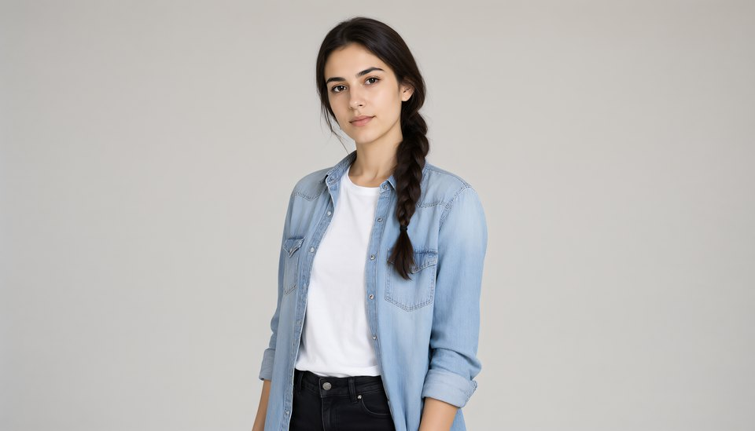
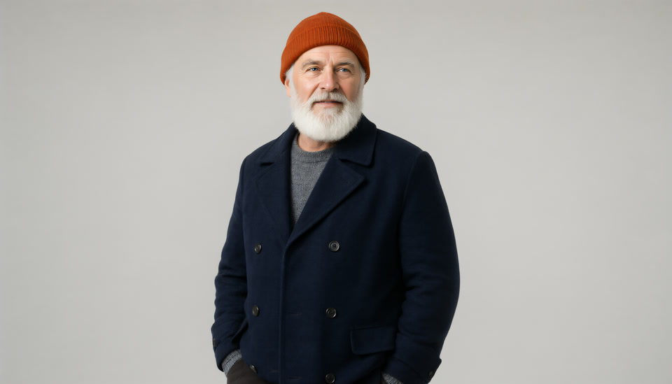
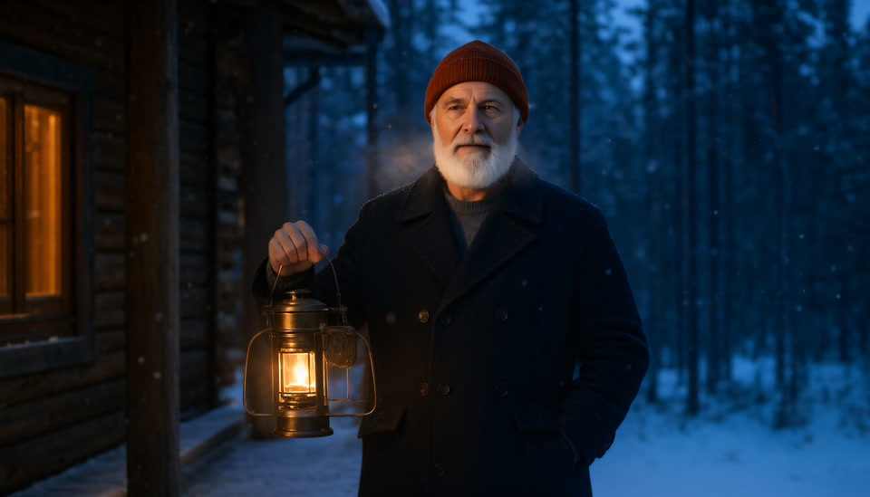

<div align="center">

# Kinoloom

**A local AI film studio for one Windows PC with an 8 GB NVIDIA graphics card and 64 GB of RAM.**

You write the story and cast the people. The studio renders the shots, joins short clips into long takes inside the model, checks the result and cuts the film, on your own machine.

[](#can-i-run-it)
[](#can-i-run-it)
[](https://python.org)
[](https://github.com/comfyanonymous/ComfyUI)
[](LICENSE)

**[Showcase](#showcase)** · **[What it can do](#what-it-can-do)** · **[Can I run it?](#can-i-run-it)** · **[How it works](#how-it-works)** · **[Docs map](docs/README.md)**

[](https://github.com/harlixay7/Kinoloom/raw/main/docs/showcase/ltx25_cliff_walk.mp4)

<sub>A 16-second take that LTX-2.5 rendered in four links and Kinoloom joined into one piece, with its sound. The joins are at 4, 8 and 12 s. Click it to download the 1280x726 mp4 with sound.</sub>

</div>

---

## What is Kinoloom?

I built Kinoloom to make short films with the newest open video models on an ordinary PC. (The name: *kino* is cinema, and a loom weaves many threads into one cloth, the way the studio joins short clips into one continuous take.) The PC it was built on has one graphics card with 8 GB of video memory (an RTX 3070), and the models are far bigger than that: LTX-2.5 has 22 billion parameters, and MiniMax H3's pruned ref2va checkpoint holds about 20 billion. Kinoloom runs them anyway. It gives the card to one model at a time, and keeps the part of a model that doesn't fit in system RAM, streaming it to the card while it works.

Around those models sits a small film studio, in a web app on your PC:

- an LLM writes the story with you, and a "bible" keeps characters and places consistent;
- image models make the cast portraits and opening frames;
- video models render the shots, and longer takes are joined in latent space instead of cut together;
- a QA step checks the prompt match and the motion (and the face, for characters with a trained face LoRA), and the assembler cuts the film.

To see what it makes, start with the [showcase](#showcase). To try it on a similar PC, read [Can I run it?](#can-i-run-it). For the engineering, go to [How it works](#how-it-works) and the [docs map](docs/README.md).

> **Status.** Kinoloom is a one-person project, and it has been tested on one machine. The model weights are not in git, and neither are the ComfyUI trees or their Python environments. The installer (`install\INSTALL-MAIN.bat`) sets them up for the parts you choose: LTX-2.5, MiniMax H3, the image models, post-processing. It downloads every weight file except the MiniMax H3 and RealVisXL ones, which you bring yourself ([Quick start](#quick-start)). The model weights come with their own licences, and some of them limit commercial use or where you may use the model ([licences](#license)).

---

## Showcase

Every video and still here was rendered on the RTX 3070 8 GB described under [Can I run it?](#can-i-run-it). Each video is a 1080p take from the seamless-chain engine, with its own sound, re-encoded at 1280x726 to keep the repository small; the previews are GIFs, and clicking one downloads its mp4. Nothing was retouched. There was some selection: one take (the letter) was re-prompted and one (a greenhouse scene) was dropped, and [SHOWCASE.md](docs/SHOWCASE.md) §14 lists every choice. How each sample was made, how long every step took, the QA numbers and what is wrong with each one: **[SHOWCASE.md](docs/SHOWCASE.md)**.

> **MiniMax H3 is supported, but not shown here.** The studio has all 11 H3 tiers, with cast references and seamless chains, and the installer sets up everything H3 needs except its weights, which you bring yourself ([MiniMax H3: bring your own weights](#4-minimax-h3-bring-your-own-weights)). The clips are missing because of the licence. The [MiniMax H3 Community License](https://huggingface.co/MiniMaxAI/MiniMax-H3/blob/main/LICENSE) grants use of the model only outside the European Union, the United Kingdom, South Korea and the United States, and its §V.4 applies the same limit to displaying the model's outputs. I live in the EU, so my H3 renders are not published. Three H3 samples were rendered for this page: the same cliff walk, a kitchen scene with two speaking parts, and a 27-second, 4-link take on a forest road. Their timings and QA results are in [SHOWCASE.md](docs/SHOWCASE.md) as text, and the requests that made them are in [docs/showcase/inputs/](docs/showcase/inputs/).

### 1. Long takes joined inside the model

Video models only make a few seconds at a time. For a longer shot you render it in pieces ("links") and join them. The usual way starts each piece from the last frame of the one before, and you can see a jump at every join. Kinoloom's **seamless-chain engine** passes the end of each link into the next one inside the model (as latents, before they become pixels), joins the links there, and turns the whole take into pixels in one go. That removes the decode cut at each join. It does not make every join perfect: in this showcase the seam QA fails one join on its pop gate (the lantern, frame 193) and flags a few others for a change in fine detail, and every take fails the drift check, because light and framing change through a story ([SHOWCASE.md](docs/SHOWCASE.md) §14).

The take at the top is the cliff walk: LTX-2.5 (`ltx25_s6_cq`, with its CQ LoRA off, as in every chain), 4 links, 16.0 s, about 28 min warm. One cast portrait and one opening frame, both made with Qwen-Image 2.1. The beats: she walks the cliff path, stops at a fence post, looks out to sea, gathers her scarf against the wind, then turns back and walks on. "Pop" below measures how much bigger the change at a join is than the normal change between frames: 1.0x means no jump, and the QA gate fails a join above 1.30x. All three joins of the cliff walk pass the pop gate (1.10x, 0.93x, 0.85x). The older engine, which started each link from the last frame, failed all three joins of an H3 forest story (3.06x, 2.25x, 2.16x); the seamless chain's take of the same story passes them (1.105x, 1.28x, 0.96x).

### 2. Two more LTX-2.5 takes

- **Letter:** a man reads a letter by a rain-streaked window at night.
- **Lantern:** an older man stands on the porch of a log cabin at blue hour while snow falls. He raises a lit storm lantern and looks out at the pines, then lowers it, closes his eyes and turns his face up into the snow.

| Letter: 4 links, 16.0 s | Lantern: 4 links, 16.0 s |
| :---: | :---: |
| [](https://github.com/harlixay7/Kinoloom/raw/main/docs/showcase/ltx25_letter.mp4) | [](https://github.com/harlixay7/Kinoloom/raw/main/docs/showcase/ltx25_lantern.mp4) |
| joins at 4.0, 8.0 and 12.0 s; about 26 min warm, plus about 7 min to re-draft links 3-4 | joins at 4.0, 8.0 and 12.0 s; about 29 min warm (29.7 min as rendered). The QA fails the join into link 3 (frame 193): the warm light on his cheek dips slightly there ([SHOWCASE.md §9](docs/SHOWCASE.md#9-ltx-25-the-lantern-in-the-snow)) |

### 3. Continuity, measured

Two of the LTX chains were also put together the simple way, each link turned into pixels on its own and then hard-cut together, and compared with the engine's take, which turns the joined links into pixels once. Same renders, same latent carry between links, same pop measure as above (gate 1.30x), so this isolates the one-decode step:

| 1080p take | Join 1 | Join 2 | Join 3 |
| :--- | :---: | :---: | :---: |
| Cliff walk: links decoded one by one, hard cut | 1.37x | 1.36x | 1.55x |
| Cliff walk: decoded once (shown above) | 1.10x | 0.93x | 0.85x |
| Letter: links decoded one by one, hard cut | 1.35x | 1.56x | 1.78x |
| Letter: decoded once (shown above) | 1.09x | 1.08x | 1.15x |


<sub>Frames 191-194 of the LTX cliff walk, across the join into link 3. The QA flags this join for a dip in detail (0.76 against 0.85), but no change is visible in these frames.</sub>

### 4. Stills: Qwen-Image 2.1

**Fast mode, 8 steps, 2688x1536.** The cast portraits came first. Each opening frame was then rendered with the portraits as Qwen's own references, so it shows the person from the portrait (judged by eye). The kitchen pair was made for the H3 kitchen take, which isn't shown. A still takes 38-78 s once the model is loaded. The first render on a fresh instance took 99 s and 116 s for the portraits (rendered in two batches) and 190 s and 225 s for the opening frames. The two opening-frame times include stalls of 125 s and 158 s in the upscale, which [SHOWCASE.md](docs/SHOWCASE.md) describes.

| Cast portrait | Opening frame (portrait as reference) |
| :---: | :---: |
|  |  |
|  |  |
|   |  |
|  |  |

**Two more from the Images page** (fast mode, 1024x1024 finished to 2048x2048; their prompts are in [docs/showcase/inputs/qwen_gallery.json](docs/showcase/inputs/qwen_gallery.json)):

| Anime style | Photo style |
| :---: | :---: |
|  |  |

### 5. How long it takes

On the RTX 3070 8 GB, **one 5-second clip at 1080p takes about 6 minutes with LTX-2.5 and about 20-22 minutes with MiniMax H3** (the recommended `ltx25_s6_cq` and the hero v2 tier). Those are warm times: the model is already loaded, which is the normal case when you render one clip after another (by default the studio keeps a model loaded for 8 minutes after a job). Where the numbers come from:
- LTX-2.5: 352 s warm, from the archived LTX lab report (quoted in the tier's `vram_note`; the report itself is not in this repo).
- MiniMax H3: 20.5 min (1,227 s) measured for a clip without reference images. With reference images, cold runs were about 7% slower per step, so about 22 min. That is an estimate: the two runs also differ in checkpoint, prompt and seed.
- The other H3 1080p tiers took 14-25 min per clip in the lab runs, depending on their step count.

**A seamless chain takes about one clip's time per link:**

| Sample | Video | Time, warm | Per link | As rendered, from a cold start |
| :--- | :--- | :---: | :---: | :---: |
| Cliff walk, LTX-2.5 | 16.0 s, 4 links | about 28 min | about 7 min | 29.5 min |
| Cliff walk, MiniMax H3 (not shown) | 12.25 s, 3 links | about 66 min | about 22 min | 70.2 min |
| Kitchen, MiniMax H3 (not shown) | 12.25 s, 3 links | about 71 min | about 24 min | 72.0 min |
| Letter, LTX-2.5 | 16.0 s, 4 links | about 26 min, plus about 7 min to re-draft links 3-4 | about 6.5 min | 33.8 min |
| Lantern, LTX-2.5 | 16.0 s, 4 links | about 29 min | about 7 min | 29.7 min |

Each chain ran as the first job on freshly started servers, so the measured times include starting the servers and loading the models. The warm column is an estimate: it takes out only those measured start-up times (the server boots, and link 1's extra time in the model loaders and the first prompt and reference encode). Everything the chain does on purpose stays in, including its server restarts before the 1080p steps.

Per second of finished video, a chain costs more than single clips. Warm, the LTX chains come to about 1.6-1.8 min per second, against 1.2 for a single LTX clip. The H3 chains come to about 5.4-5.8 min per second, against about 4.0-4.3 for a single H3 clip. There are two reasons. Each link renders its overlap with the link before it again, and that overlap is what hides the join. The chain also has steps a single clip doesn't: a preview of the whole take, QA of every join, and for H3 the restarts.

The 27-second H3 forest take has no wall time like the rows above, because it was rendered over several lab runs. Its steps add up to 2 h 15 min of step time: 79.8 min for the four links, 3.7 min for the 544p preview take and 51.6 min for the 1080p refine and decode. That is with the refine chosen for it (from sigma 0.25); the alternative from sigma 0.45 took longer, about 2 h 40 min in total, which is the figure the seamless-chain docs give for this gate. The PC blue-screened three times during the H3 tests, twice between this take's steps. The records point at H3 models being dropped in-process between steps, by the lab harness or by ComfyUI's cache (likely, not proven). The harness and the engine now restart the H3 server instead, and the Windows event log has shown no crash since; that is consistent with the cause, not proof of it ([SEAMLESS_CHAINS_02](docs/research/SEAMLESS_CHAINS_02_H3_MEMORY_AND_CRASHES.md) §5).

The draft-against-1080p crop and every per-step timing are in [SHOWCASE.md](docs/SHOWCASE.md).

---

## What it can do

| | What you get |
| :--- | :--- |
| **Write the story** | The Story Architect asks an LLM for a story outline, then the shots, scene by scene. It speaks the OpenAI-compatible `/chat/completions` API; the default is a local Ollama. A canon linter checks every shot against the story bible and fixed vocabularies (camera moves, shot sizes, stage positions, continuity rules), and sends broken scenes back to the LLM. |
| **Cast the people and places** | Cast & World holds characters, locations and reference images. Qwen-Image 2.1 can use a portrait as a reference, so the scene shows the person from the portrait (judged by eye). |
| **Render with many models** | 5 image models (6 setups: Qwen-Image 2.1 has a quality and a fast mode) and 18 video tiers in four groups: LTX-2.5, MiniMax H3 at 1080p, MiniMax H3 drafts, and the legacy Wan 2.2. You pick the model per project or per shot; a project that picks none renders on LTX-2.5 (`ltx25_s6_cq`) ([models](#models)). |
| **Make long takes** | Seamless chains for LTX-2.5 (the `ltx25_s6_cq` tier) and every MiniMax H3 tier, in Video Studio and in the movie pipeline's continuous takes. Video Studio shows the progress of every step and, on LTX-2.5, plays each segment as soon as it is rendered, before the whole take is done. |
| **Keep shots connected** | On LTX-2.5 and H3, a run of shots that continue each other renders as one seamless take (on by default, per project; still experimental, see [known limitations](#known-limitations)). Otherwise the studio picks the sharpest of a shot's last 5 frames as the next shot's start image. |
| **Check the result** | The QA director checks the prompt match (CLIP, when the model is installed) and the motion. For a character with a trained face LoRA it also compares the face with the shot's approved keyframe (InsightFace). With post-processing on, a failing shot is retried within its tier's budget (by default one new seed for a standard shot; a new seed, then a simpler prompt for a hero shot), then sent to you for review. |
| **Finish and cut** | Optional post-processing: upscale, face fix (it runs on the legacy Wan 2.2 model), frame interpolation (RIFE) and a LUT colour grade. The assembler joins the passed clips into scenes and the film, as a draft and a master. |
| **Train your own LoRAs** | The Training page trains LoRAs (character, environment and more) with ai-toolkit, sized for an 8 GB card, from datasets the studio helps you collect and curate. They are for the legacy Wan 2.2 TI2V-5B model only: LTX-2.5 and MiniMax H3 shots take the cast's reference images instead. |
| **Spread the work** | Optional render workers on other PCs on your network, for image, legacy Wan 2.2 and post/upscale jobs; LTX-2.5 and MiniMax H3 movie shots always render on this PC ([DISTRIBUTED_FLEET.md](docs/setup/DISTRIBUTED_FLEET.md)). There is also a Google Colab worker ([colab/README.md](colab/README.md)). |

### Models

| Kind | What the studio registers |
| :--- | :--- |
| Image | Qwen-Image 2.1 (quality, and fast with an 8-step LoRA), Z-Image Turbo, RealVisXL V5 and CyberRealistic XL (SDXL), and the legacy Wan 2.2 (listed last, not recommended) |
| Video: LTX-2.5 22B, W4A8 | 6 tiers, among them the recommended `ltx25_s6_cq` (5 s at 1080p, about 6 min warm) and a 10-second slow-motion tier |
| Video: MiniMax H3, W4A8 | 6 tiers at 1080p (two-phase: sample at 960x544, refine at 1920x1088) and 5 lower-resolution tiers at 544p and 768p (the UI groups them as drafts) |
| Video: Wan 2.2 TI2V-5B (legacy) | 1 tier (Q4_K_M, 832x480 plus a post upscale). It was the studio's first video model and stays for old projects only: it is not as good as LTX-2.5 or MiniMax H3, and it is not recommended for new work. The studio never picks it as a video model on its own. Post-processing's face fix and V2V refine still run Wan 2.2 graphs, so they need its files |

Names in code font, such as `ltx25_s6_cq` or `minimax_h3_hero_v2`, are tier ids; the UI shows them with plain labels ("Quality 5 s", "Hero v2 · 32-step"). Every tier and its settings are in `tool/video_models.py` and `tool/video_models_user.json`. The time notes there are a mix: some measured, some planning estimates, and a few tiers have none. To add your own: [install/ADD-A-MODEL.md](install/ADD-A-MODEL.md). Each model comes with its own license; [THIRD_PARTY_NOTICES.md](THIRD_PARTY_NOTICES.md) section 3 summarises what they allow.

### The web app

The control room is a web app at `http://127.0.0.1:8080`, with one sidebar for both pages:

- **Project** (`/`, also `/project`): one movie at a time. Overview, Story, Cast & World, Shots, Generate (video model, post-processing, VRAM, render queue, LoRAs), Review and Film.
- **Studio** (`/studio-tools`): Video Studio, Images, Training and the video Library.
- **System**: Queue, Workers, Settings (configuration, the global bible files, your browser's API token) and Logs.

---

## Can I run it?

Kinoloom has been tested on one machine, so the right-hand column is a reasoned guess rather than a tested minimum.

| | Tested machine | What you probably need |
| :--- | :--- | :--- |
| **Operating system** | Windows 11 Pro | Windows. The studio uses Windows-only features to manage its processes. |
| **Graphics card** | NVIDIA RTX 3070, 8 GB | An NVIDIA card with 8 GB or more from a recent generation. Speed, heat and memory behaviour on other cards are unmeasured. |
| **System memory** | 64 GB | The big video models keep part of their weights in RAM, so plan on 64 GB. |
| **Disk** | the model folders hold about 211 GB: 85.4 GB in `models/`, plus 94.3 GB (H3) and 31.0 GB (LTX-2.5) in two extra model folders | Only the files for the models you use. On the tested machine the H3 weights sit on a hard drive: in the showcase, the first (cold) H3 load took 72.1 s, against 1.9 s when the files were already in the Windows file cache. |
| **Patience** | a 5-second 1080p clip takes about 6 minutes with LTX-2.5 and about 20-22 minutes with MiniMax H3, warm; a seamless chain takes about one clip's time per link ([render times](#5-how-long-it-takes)) | These are big models on a small card. It is not real time. |

<details>
<summary><b>Exact hardware and software of the tested machine</b></summary>

| Part | Tested machine | Notes |
| :--- | :--- | :--- |
| **GPU** | NVIDIA GeForce RTX 3070, 8 GB (Ampere, SM 8.6) | The tiers, VRAM estimates and timings in this repository come from this card. |
| **NVIDIA driver** | 616.64 (tested) | R560 or newer for the CUDA 12.6 runtimes (studio venv, render farm 8188, Qwen 8190). R580 or newer for the CUDA 13.0 runtime in `ComfyUI_LTX/venv` (torch cu130: LTX-2.5 on 8189, MiniMax H3 on 8199). The `581.57` in `tool/versions.txt` is a historical pin. |
| **System RAM** | 64 GB DDR4, quad-channel | Weights that do not fit on the card are staged in system RAM. For example, the `LTX25EvictModels` note records 10.6 GB for the LTX-2.5 text encoder. |
| **CPU** | Intel Core i9-10980XE (18 cores / 36 threads) | Qwen-Image 2.1 text encoding and InsightFace QA run on the CPU. The launcher sets `OMP_NUM_THREADS` for the render farm to the CPU's thread count (36 here). |
| **PCIe** | 3.0 x16 | Weight streaming under DynamicVRAM crosses this bus. |
| **OS** | Windows 11 Pro | The launcher uses Win32 APIs (Job Objects, console control handler). The studio itself is Windows-only; the worker agent and CI also run on Linux. |
| **Python** | 3.12, 64-bit (embedded `tools/python` is 3.12.10) | The installer accepts only 3.12 (`install/INSTALL-MAIN.bat`), and the pinned scipy 1.18.0 needs at least 3.12. |

Other GPUs (the RTX 3060 12 GB and the RTX 40 series among them) and other memory setups have not been benchmarked.

</details>

If you run it on other hardware, a report helps a lot: see [Help test more hardware](#help-test-more-hardware).

---

## Quick start

The model weights are not in this repository, and neither are the three ComfyUI trees' upstream files or their Python environments. The installer sets them up. You choose which parts you want: LTX-2.5, MiniMax H3, the image models, post-processing, each on its own. For every part it installs the ComfyUI tree it runs on, that tree's node packs and Python environment, and the part's weights.

**Before you start** you need Windows, [Python 3.12 64-bit](https://www.python.org/downloads/) (`winget install -e --id Python.Python.3.12`), [Git for Windows](https://git-scm.com/) (`winget install -e --id Git.Git`) and an NVIDIA driver: R580 or newer for LTX-2.5 and MiniMax H3, R560 or newer for the rest. You also need disk space for the parts you pick (sizes below).

### 1. Clone
```cmd
git clone https://github.com/harlixay7/Kinoloom.git C:\Kinoloom
cd /d C:\Kinoloom
```

Keep the folder path short, like `C:\Kinoloom`. In a full install the deepest file inside a venv sits 211 characters below the studio folder, and Windows stops at 260 characters unless [long paths are enabled](https://learn.microsoft.com/en-us/windows/win32/fileio/maximum-file-path-limitation). With a folder path longer than about 45 characters, `pip install` can fail partway.

### 2. Run the installer and choose your parts
```cmd
install\INSTALL-MAIN.bat
```
Choose mode **[1]**. It sets up the control room first: it finds Python 3.12, creates `tool\.venv` from `tool\requirements.txt` (torch from the CUDA 12.6 index), creates the studio's folders and copies `tool\settings.example.yaml` to `tool\settings.yaml`. Then it lists the parts and asks which ones to install:

| # | Part (id) | Downloads | What it installs |
| :---: | :--- | ---: | :--- |
| 1 * | LTX-2.5 video (`ltx25`) | 28.8 GB | The default video model: every LTX-2.5 tier, cast references, seamless chains, sound. |
| 2 | MiniMax H3 video (`h3`) | none: you bring 10 files (63.2 GB) | All 11 H3 tiers and the H3 seamless chains. It installs the runtime and checks your files; the weights are not downloaded (see [step 4](#4-minimax-h3-bring-your-own-weights)). |
| 3 * | Qwen-Image 2.1 images (`qwen21`) | 15.4 GB | Cast portraits and opening frames: quality and fast (8-step) modes, reference images, a 2K upscale. |
| 4 * | Post-processing (`post`) | 0.1 GB | Frame interpolation (RIFE), 4x upscale (Real-ESRGAN), and the face detector that cast import, dataset curation and the face fix use (the face fix also needs Wan 2.2). |
| 5 | SeedVR2 video upscaler (`seedvr2`) | 4.2 GB | The optional SeedVR2 3B upscale for post (`tiers.upscale: seedvr2`). Slower than Real-ESRGAN; off by default. |
| 6 | Z-Image Turbo images (`zimage`) | 13.4 GB | A fast 8-step image model (no reference images, no LoRAs). |
| 7 | CyberRealistic XL images (`cyberrealistic`) | 10.3 GB | A native SDXL checkpoint with LoRAs and reference images (IP-Adapter). |
| 8 | RealVisXL V5 images (`realvis`) | 3.4 GB, and you bring 4 files | The runtime, IP-Adapter and the hires upscaler; the four RealVisXL files are not downloaded (see [step 5](#5-realvisxl-bring-your-own-weights)). |
| 9 | Wan 2.2 video, legacy (`wan22`) | 8.8 GB | The first video model, kept for old projects, the post face fix and the V2V refine. Not recommended for new work. |

Type the numbers or ids you want, separated by commas (`1,2,3,4`). **Enter alone installs the three marked \* (LTX-2.5, Qwen-Image 2.1 and post-processing)**, and `all` installs everything. GB here is 10⁹ bytes, and a file that two parts share is counted in both. The LTX-2.5/H3 and Qwen-Image trees each also get a Python environment: about 4.2 and 5.5 GB on the tested machine.

Before it changes anything, the installer shows the plan, the free disk space and the licence of every model in it, and asks you to confirm. Then, for each part, it:

- copies the pinned ComfyUI release into the part's tree (`ComfyUI\` v0.30.0, `ComfyUI_LTX\` v0.36.0 or `ComfyUI_Qwen21\` v0.37.4) without overwriting the files git tracks there;
- adds the node packs it needs, each at a pinned commit;
- builds the tree's venv from the frozen package list in `install\requirements-frozen\`;
- downloads the weights from Hugging Face (Real-ESRGAN and RIFE from GitHub), checks each file's size and SHA-256 against `install\components.json`, and deletes and reports a file that doesn't match;
- downloads ffmpeg 9.0 into `tools\ffmpeg\` if none is on your PATH.

The downloads are big: LTX-2.5 alone is 28.8 GB. If a step fails, or you stop the installer, run it again: finished steps are skipped, and the studio starts with whatever is installed. The launcher skips a ComfyUI instance whose tree or venv is missing, and lists a model as not installed until its files are there.

### 3. Where everything goes
The installer prints the full path of every file it installs. With the clone at `C:\Kinoloom`:

| What | Where |
| :--- | :--- |
| Model weights | `C:\Kinoloom\models\<folder>\`, for example `models\diffusion_models\`, `models\text_encoders\`, `models\vae\`, `models\loras\` ([the full tree](#model-files)) |
| Post-processing models | inside `C:\Kinoloom\ComfyUI\`: RIFE in `custom_nodes\ComfyUI-Frame-Interpolation\ckpts\rife\`, the face detector in `models\ultralytics\bbox\` and `models\onnx\bbox\`, SeedVR2 in `models\SEEDVR2\` |
| ComfyUI | `C:\Kinoloom\ComfyUI\` (render farm, runs on `tool\.venv`), `C:\Kinoloom\ComfyUI_LTX\` and `C:\Kinoloom\ComfyUI_Qwen21\`, each with its own `venv\` |
| ffmpeg | `C:\Kinoloom\tools\ffmpeg\bin\` |
| Settings | `C:\Kinoloom\tool\settings.yaml` |

All three ComfyUI trees read their weights from `models\`. To keep weights on another drive, give that folder the same subfolders and list it in `paths.extra_model_dirs` in `tool\settings.yaml`.

### 4. MiniMax H3: bring your own weights
The studio supports MiniMax H3 alongside LTX-2.5, but the installer never downloads its weights. The [MiniMax H3 Community License](https://huggingface.co/MiniMaxAI/MiniMax-H3/blob/main/LICENSE) grants no use in the EU, the UK, South Korea or the USA, and the installer can't know where you are. Part 2 (`h3`) installs everything else H3 needs: the `ComfyUI_LTX` tree, its venv and node packs. Then:

1. Read the licence, and check that it allows you to use H3 where you live.
2. Download the files from where they are published. These are the builds the studio was tested with; the installer checks their sizes.
3. Put them in `C:\Kinoloom\models\`, in the folders below. Or keep them in a folder of your own with the same subfolders (for example `D:\H3\models\diffusion_models\...`) and register it:
   ```cmd
   tool\.venv\Scripts\python install\install_components.py --components h3 --h3-dir D:\H3\models
   ```
   (The installer also asks for this folder when you choose part 2.)
4. Check: `tool\.venv\Scripts\python install\install_components.py --check` lists every H3 file as found or missing.

| File (under `models\`) | Size | Needed by | Published at |
| :--- | ---: | :--- | :--- |
| `text_encoders\qwen3vl_32b_minimax_h3-w4a8_convrot.safetensors` | 15.70 GB | every H3 tier | [koongrizzly/MiniMax_H3_int4_W4A8_ConvRot_Pruned](https://huggingface.co/koongrizzly/MiniMax_H3_int4_W4A8_ConvRot_Pruned) |
| `vae\minimax_h3_video_vae_fp16.safetensors` | 5.21 GB | every H3 tier | [Comfy-Org/MiniMax-H3](https://huggingface.co/Comfy-Org/MiniMax-H3) |
| `vae\minimax_h3_audio_vae_fp32.safetensors` | 0.61 GB | every H3 tier | [Comfy-Org/MiniMax-H3](https://huggingface.co/Comfy-Org/MiniMax-H3) |
| `diffusion_models\minimax_h3_ref2va_pruned-w4a8_convrot_pruned.safetensors` | 12.54 GB | the ref2va tiers: hero, hero v2, base25, larry6, turbo4 and the PDD-8 draft | [koongrizzly/MiniMax_H3_int4_W4A8_ConvRot_Pruned](https://huggingface.co/koongrizzly/MiniMax_H3_int4_W4A8_ConvRot_Pruned) |
| `diffusion_models\minimax_h3_fl2va_pruned-w4a8_convrot_pruned.safetensors` | 12.54 GB | the fl2va draft tiers: 768p, 544p and 544p/25 | [koongrizzly/MiniMax_H3_int4_W4A8_ConvRot_Pruned](https://huggingface.co/koongrizzly/MiniMax_H3_int4_W4A8_ConvRot_Pruned) |
| `diffusion_models\Minimax-h3_Singularity_ref2va_v1.3_Pruned_w4a8.safetensors` | 11.77 GB | the two Singularity tiers | [WarmBloodAban/Minimax-h3_Singularity](https://huggingface.co/WarmBloodAban/Minimax-h3_Singularity) |
| `latent_upscale_models\minimax_h3_latent_upscaler_3d_conv_v1_bf16.safetensors` | 0.69 GB | the 1080p tiers, and the 1080p refine of every H3 seamless chain | [LBH-123-AI/Minimax_h3_latent_Upscaler](https://huggingface.co/LBH-123-AI/Minimax_h3_latent_Upscaler) |
| `loras\minimax_h3_turbo_v4_step600_ema.safetensors` | 0.78 GB | the larry6 1080p tier | [larryvrh/MiniMax-H3-Turbo-Lora](https://huggingface.co/larryvrh/MiniMax-H3-Turbo-Lora) |
| `loras\minimax_h3_ref2v_turbo_4step_v0.1_comfyui_bf16.safetensors` | 1.96 GB | the turbo4 1080p tier | [RunningHubAI/rh-minimax-h3-ref2v-turbo-4step-v0.1-comfyui-bf16.safetensors-lora](https://huggingface.co/RunningHubAI/rh-minimax-h3-ref2v-turbo-4step-v0.1-comfyui-bf16.safetensors-lora) |
| `loras\MiniMax-H3-Ref2VA-Acc-8Step.safetensors` | 1.37 GB | the PDD-8 draft tier | [alibaba-pai/MiniMax-H3-Acc-LoRAs](https://huggingface.co/alibaba-pai/MiniMax-H3-Acc-LoRAs) |

You don't need all ten: a tier is available as soon as the files it uses are there. The first three serve every tier. With them plus the Singularity DiT and the upscaler you have the two tiers the studio marks as recommended, Singularity 1080p (`minimax_h3_singularity32`) and its 544p draft. Several of these repositories are community quantisations of MiniMax H3; whatever licence their cards show, the MiniMax H3 Community License applies to the model.

### 5. RealVisXL: bring your own weights
RealVisXL V5 is an optional SDXL image model, and the default model for keyframe stills. The four RealVisXL files the studio was tested with have no public copy to check against, so part 8 installs everything around it (the render farm, IP-Adapter, the hires upscaler) but not the files themselves: `models\diffusion_models\RealVisXL_V5.0-Q5_K_M.gguf` (a Q5_K_M GGUF of the [RealVisXL V5](https://huggingface.co/SG161222/RealVisXL_V5.0) UNet), `models\clip\clip_l.safetensors` and `models\clip\clip_g.safetensors` (the SDXL text encoders) and `models\vae\xlVAEC_c91.safetensors` (an SDXL VAE). Without them, keyframes use the first installed of Qwen-Image 2.1, Z-Image Turbo and CyberRealistic XL instead.

### 6. Add parts later, or check what you have
Run `install\INSTALL-MAIN.bat` again and choose mode **[3]**, or call the installer directly:
```cmd
tool\.venv\Scripts\python install\install_components.py --list
tool\.venv\Scripts\python install\install_components.py --components zimage,wan22
tool\.venv\Scripts\python install\install_components.py --components all --dry-run
tool\.venv\Scripts\python install\install_components.py --check
```
`--check` changes nothing. It reports each part as installed, partly installed or not installed, lists every missing file with its full path, and ends with the video tiers and image models the studio can see.

Mode **[2]** of `INSTALL-MAIN.bat` is the other way in: it mirrors a complete studio from another PC or a share with `robocopy /E` ([RESTORE_INSTRUCTIONS.md](docs/setup/RESTORE_INSTRUCTIONS.md) has the details, and the manual steps behind the installer).

### 7. Configure
Look through `tool/settings.yaml`: `paths.*` (including `paths.extra_model_dirs` for weights outside the tree), `ui.host`/`ui.port`, and `architect.*` for the Story Architect, which can use any OpenAI-compatible `/chat/completions` endpoint (the default `base_url` is a local Ollama at `http://127.0.0.1:11434/v1`). `ui.host: 127.0.0.1` keeps the studio on this PC. Read [SECURITY.md](SECURITY.md) before you set `0.0.0.0`.

### 8. Start the studio
```cmd
start.bat
```
`start.bat` runs `tool\launcher.py` with `tools\python` (or `tool\.venv`, or `python` on PATH). The launcher starts the control room and the four ComfyUI instances in one console window, tails their logs (`logs\*.log`), and stops everything on Ctrl+C or when you close the window. The control room creates its SQLite databases (`tool/studio.db`, `tool/queue.db`, `tool/datasets.db`) on first use.

### 9. Open the web app
- **Project:** [http://127.0.0.1:8080/](http://127.0.0.1:8080/) (also `/project`)
- **Studio tools:** [http://127.0.0.1:8080/studio-tools](http://127.0.0.1:8080/studio-tools)

---

## How it works

A model bigger than the card can only run if it has the card to itself, streams its extra weights from system RAM, and is cleared out properly before the next job. Everything below is built around that.

```
+---------------------------------------------------------------------------------------------------+
|                           FASTAPI CONTROL ROOM (tool/api.py, port 8080)                           |
|  * Web UI (/, /project, /studio-tools)    * SQLite state (tool/studio.db, queue.db, datasets.db)  |
|  * Shot orchestration and post-processing * Started by tool/launcher.py (Win32 Job Object)        |
+---------------------------------+---------------------------------+-------------------------------+
                                  |                                 |
                        local GPU leases                   worker job dispatch
                                  |                                 |
                                  v                                 v
+----------------------------------------------------+  +-------------------------------------------+
|       GPU LEASE BROKER (tool/gpu_broker.py)        |  |     OPTIONAL WORKER AGENT (port 8120)     |
|  * One local render at a time (FIFO lease)         |  |  * LAN PC or Colab box with own ComfyUI   |
|  * Other instances evicted and verified empty      |  |  * One shared fleet token                 |
|    (/queue empty, VRAM back at boot baseline)      |  |  * Not covered by the local broker        |
|  * Warm model TTL (default 8 min)                  |  +-------------------------------------------+
|  * Eviction: ComfyUI /free; H3 is restarted        |
+---------------------------------+------------------+
                                  |
            +---------------------+---+-------------------------+-------------------------+
            |                         |                         |                         |
            v                         v                         v                         v
+-----------------------+ +-----------------------+ +-----------------------+ +-----------------------+
|    PRODUCTION FARM    | |     LTX-2.5 FARM      | |    MINIMAX H3 FARM    | |   QWEN STILLS FARM    |
|      (port 8188)      | |      (port 8189)      | |      (port 8199)      | |      (port 8190)      |
| * SDXL: RealVisXL,    | | * LTX-2.5 22B W4A8    | | * MiniMax H3 W4A8     | | * Qwen-Image 2.1 7.1B |
|   CyberRealistic XL   | | * --enable-dynamic-   | | * --enable-dynamic-   | | * text encoder on CPU |
| * Z-Image Turbo (6B)  | |   vram, --bf16-vae    | |   vram, fp16 VAE      | | * --highvram          |
| * Wan 2.2 (legacy)    | |                       | | * own SQLite DB       | |                       |
+-----------------------+ +-----------------------+ +-----------------------+ +-----------------------+
            |                         |                         |                         |
            +-------------------------+-------------------------+-------------------------+
                                                   |
                                                   v
                              +-----------------------------------------+
                              |  ONE NVIDIA GPU (tested: RTX 3070 8 GB) |
                              +-----------------------------------------+
```

In plain words: one web app (the control room) runs the whole studio. Behind it, four ComfyUI servers host the models. They run from three ComfyUI copies, because the models need different ComfyUI versions; LTX-2.5 and MiniMax H3 share one copy on two ports. A broker in the control room makes sure only one of them uses the graphics card at a time. Optional workers on other computers can take render jobs too.

The models: SDXL, Z-Image Turbo and the legacy Wan 2.2 on the production farm; LTX-2.5 (22B, W4A8); MiniMax H3 (pruned W4A8 checkpoints of a base model described as 33B; the ref2va checkpoint holds about 20B logical parameters); and Qwen-Image 2.1 (7.1B).

<details>
<summary><b>Ports and launch commands</b></summary>

These are the launch commands as `tool/launcher.py` builds them. When `paths.extra_model_dirs` is set and one of its folders exists, every ComfyUI instance also gets `--extra-model-paths-config temp/extra_model_paths.studio.yaml`.

| Service | Port | Process command | Role and limits |
| :--- | :---: | :--- | :--- |
| **Control Room** | `8080` | `python -m uvicorn api:app --host <ui.host> --port <ui.port>` (default `127.0.0.1:8080`) | Web UI, REST API, shot orchestrator, post-processing and assembly. |
| **Production Farm** | `8188` | `ComfyUI/main.py --port 8188 --default-device 0 --disable-auto-launch` | ComfyUI v0.30, run by the base Python (`tools/python` when present) with `tool/.venv` site-packages on `PYTHONPATH`. SDXL (RealVisXL, CyberRealistic XL), Z-Image Turbo, the legacy Wan 2.2 TI2V-5B (only for projects or shots that pick it), post/upscale graphs. Listens on ComfyUI's default `127.0.0.1`. |
| **LTX-Video Farm** | `8189` | `ComfyUI_LTX/main.py --port 8189 --listen 127.0.0.1 --enable-dynamic-vram --bf16-vae --disable-auto-launch` | ComfyUI v0.36 from `ComfyUI_LTX/venv` (torch cu130). LTX-2.5 22B W4A8 tiers. |
| **MiniMax H3 Farm** | `8199` | `ComfyUI_LTX/main.py --port 8199 --listen 127.0.0.1 --enable-dynamic-vram --database-url sqlite:///<root>/ComfyUI_LTX/user/comfyui_h3.db --disable-auto-launch` | Same tree and venv as 8189, without `--bf16-vae` (the H3 video VAE is fp16). Its own SQLite file, because two servers on one database file hit lock errors. |
| **Qwen Stills Farm** | `8190` | `ComfyUI_Qwen21/main.py --port 8190 --listen 127.0.0.1 --highvram --disable-auto-launch` | ComfyUI v0.37.4 from `ComfyUI_Qwen21/venv` (torch cu126). Qwen-Image 2.1 stills. `--highvram` because without it the Q5_K GGUF kept falling into per-module CPU dequantization (per the launcher's note). |
| **Worker Agent** | `8120` | `python worker_agent.py` (from `tool/worker/`, on the worker PC) | Optional remote render worker on a LAN PC or cloud box. Binds `0.0.0.0`; the port comes from the agent's `worker_config.yaml` (`agent_port`). |

</details>

### The four rules that make it fit

**1. Fit large models on 8 GB under WDDM.**
Under the Windows display driver model (WDDM), an allocation beyond the card's VRAM can spill into shared system memory instead of failing with an out-of-memory error, and sampling then slows down sharply (measurements in [docs/research/HARDWARE_BENCHMARKS_AND_LIMITS.md](docs/research/HARDWARE_BENCHMARKS_AND_LIMITS.md)). The studio keeps each job inside the card with:
- **One model stack at a time:** the GPU lease broker below.
- **Weight streaming on the video instances:** 8189 and 8199 run with `--enable-dynamic-vram`, so DiT weights that do not fit stay in system RAM and are streamed over PCIe during sampling. The Qwen instance (8190) runs `--highvram` instead, which turns DynamicVRAM off.
- **Text encoders off the card where the graph allows it:** the Qwen-Image 2.1 graph loads its text encoder on the CPU (`tool/workflows/qwen21_t2i.json`, `TextEncodeQwenImage21CPU`). The LTX-2.5 and H3 graphs load theirs with `device: default` and rely on ComfyUI's own memory management. With `gpu_broker.evict_keep_conditioning` (default on), warm evictions keep the prompt-conditioning cache.

**2. One job on the GPU at a time (`tool/gpu_broker.py`).**
The broker serializes work across the four local instances:
- **Global lease:** one local render at a time across ports 8188, 8189, 8199 and 8190, granted in FIFO order. Remote worker ports get a no-op lease (workers serialize themselves).
- **Clean start for every job:** before a job starts, every other instance that is not already recorded as empty is evicted and verified empty: its `/queue` is empty and the free VRAM it reports is back within `vram_tolerance_mb` (default 512 MB) of its boot baseline. Until a baseline is recorded, 5,500 MB free counts as empty. If verification does not succeed within `verify_timeout_s` (default 60 s), the instance is restarted (`restart_on_verify_fail`). If it still is not empty, the lease fails rather than starting the render.
- **Eviction:** a busy instance gets `/interrupt` and a queue clear, then `POST /free` with `unload_models`. The MiniMax H3 instance is restarted instead (`h3_mode: restart`; per the broker's notes, its aimdo 0.5.3 build livelocks on `/free` followed by a reload).
- **Warm model TTL:** after a job, the instance keeps its model loaded for `default_ttl_minutes` (default 8, per-model overrides in `ttl_minutes`), so a follow-up job on the same model skips the reload. When the TTL runs out, an instance whose queue is still running is left alone. A new lease for another instance still evicts it (`/interrupt` and a queue clear).
- **One entry point:** `renderer.ComfyClient.queue_prompt` takes an implicit per-prompt lease when the caller holds none. Scripts in other processes that use it lease over HTTP from the control room (`KINOLOOM_BROKER_URL`, default `http://127.0.0.1:8080`) and fail if it is unreachable. `KINOLOOM_ALLOW_UNBROKERED=1` skips the broker entirely. A few lab scripts (`tool/scripts/bench.py`, `smoke_video.py`) post to ComfyUI directly, without a lease.
- **Reconcile:** at startup and after resume from sleep, every instance is brought to a verified empty state.

**3. Clear the card before the LTX-2.5 decoder.**
On Windows, building the LTX-2.5 diffusion decoder while the DiT was still resident raised an access violation (ComfyUI issue #15606, as recorded in the node's docstring). The studio node `LTX25EvictModels` (`ComfyUI_LTX/custom_nodes/ComfyUI-LTX25-Studio/__init__.py`) sits between the last sampler and the decoder in the `tool/workflows/ltx25_*.json` graphs. It frees GPU memory and passes its input through. The studio graphs set `keep_text_encoder: true`, so they take the `free_memory` branch that keeps the text encoder:
```python
mm.unload_all_models()   # with keep_text_encoder=True: free_memory(...) keeping the text encoder
mm.soft_empty_cache()
gc.collect()
torch.cuda.synchronize()
torch.cuda.empty_cache()
torch.cuda.ipc_collect()
```
The videolab copy of this node is named `LTX25LabEvictModels`. The MiniMax H3 graphs do not use it.

**4. No orphaned processes (Win32 Job Objects).**
`tool/launcher.py` puts every component it starts (the control room and the ComfyUI instances) into a Windows Job Object with `JOB_OBJECT_LIMIT_KILL_ON_JOB_CLOSE` (`0x2000`), and a few seconds later adds the component's descendants too (best effort). The short model warm-up script (`tool/scripts/warm_studio.py`) is started without it. When the launcher exits, Windows ends them all, so no orphaned process keeps holding VRAM. Ctrl+C or closing the window also kills the recorded children and sweeps only processes whose command line is one of the studio's own (`launcher.is_studio_cmd`: a ComfyUI on a studio port, or `uvicorn api:app` on the UI port). A crashed component is restarted, and left stopped after 3 consecutive crashes that each came within 45 s of its start. The LTX-2.5, H3 and Qwen instances are skipped with a message when their venv is missing; there is no fallback to the base Python.

More: [docs/ARCHITECTURE.md](docs/ARCHITECTURE.md).

### From story to film

```
[Narrative Bible] -> [Story Architect] -> [Canon Linter] -> [Keyframes]
                                                                 |
                                                                 v
[Master Film] <--- [Assembler] <--- [QA Director] <--- [Post (optional)] <--- [Video Render]
```

1. **Narrative Bible (`bible/`, local data):** `universe.yaml`, characters, locations and LUTs. `tool/bible.py` loads the bible; the post step (`tool/post.py`) reads the LUT files.
2. **Story Architect (`tool/storygen_llm.py`):** asks the configured LLM for a story spine, then for shots scene by scene (the prompts assume 5-second clips). Replies are parsed by `llm.extract_json`, which handles fenced blocks and salvages truncated JSON. A scene the linter rejects is sent back to the LLM with the errors. If a scene still fails, the job does not abort: it ends with stage `partial` and a `failed_scenes` list.
3. **Canon Linter (`tool/linter.py`):** checks shots against the Bible and fixed vocabularies: camera moves, shot sizes, a 3×3 grid of stage positions (foreground/midground/background × left/center/right), continuity types and their CUT rules, dialogue characters and emotions, and the selected model's reference-image budget. Errors block a scene package. Warnings, such as a time-of-day change across a CONTINUE edge, do not.
4. **Keyframes (`tool/keyframe_gen.py`, optional):** candidate start stills for a shot, made when you ask for them on its shot card. They render with an Images-tab model (`keyframes.model`, default RealVisXL, on 8188; when that model isn't installed, the first installed of Qwen-Image 2.1, Z-Image Turbo and CyberRealistic XL); `keyframes.model: wan` keeps the old Wan 2.2 graphs. An approved keyframe becomes the start image of a legacy Wan 2.2 render only; LTX-2.5 and H3 shots use the cast references and, for a shot that continues the previous one, its tail frame.
5. **Video Render (`tool/orchestrator.py`):** a single loop thread renders queued shots, and every prompt it submits goes through the GPU broker. On its first start it re-queues shots left in the rendered/post stages. A shot renders on the LTX-2.5 or MiniMax H3 tier that it or its project picks (8189 or 8199). A project that picks none, or picks a tier that is not installed, renders on the default `ltx25_s6_cq` (or on the first installed LTX-2.5 or H3 tier when that one is missing); with no LTX-2.5 or H3 tier installed, the shot goes to review with an error. Only an explicit pick of the legacy Wan 2.2 model, and shots sent through the API without a project (`/api/shots/ingest`), take the Wan 2.2 path on 8188.
6. **Tail-Frame Extraction (`tool/continuity.py`):** picks the sharpest of the clip's last 5 frames (Laplacian variance plus edge density) as the start image for a following CONTINUE or MATCH_ACTION shot.
7. **Post (`tool/post.py`, optional):** runs in a background thread while the next shot renders. Post-processing is a per-project switch and is off by default, in which case the raw render is the deliverable. When on, each shot gets an upscale, RIFE only when the target fps exceeds the source fps, a LUT grade (`post.lut`), then an encode. Face-fix (deltas propagated to in-between frames) runs only when `post.face_fix` is on and the shot is a close-up of a main or supporting character, and never for the volume tier. Output fps is probed from the source clip and the source audio is kept.
8. **QA Director (`tool/qa_director.py`):** CLIP prompt alignment when the CLIP model is available locally, and a Farneback optical-flow motion range. For a main, supporting or recurring character that has a trained face LoRA (`models/loras/<id>_face.safetensors`), it also measures InsightFace (`buffalo_l` on the CPU) face similarity against the shot's approved keyframe. Freeze detection is advisory and does not fail a shot. With post-processing on, a failing shot climbs the retry ladder, `reseed`, `simplify_prompt`, `adjust_lora` (halves enabled VFX/Camera/Motion LoRA strengths), `regen_keyframe`, until its tier's retry budget runs out (`qa.max_retries`, default hero 3, standard 2, volume 1), and then goes to `review` by a human. With the defaults, a standard shot gets one reseed and a hero shot a reseed and a simpler prompt. With post-processing off, a failing raw render is flagged for review and not re-rendered.
9. **Master Assembly (`tool/assembler.py`):** per-project scene files `output/scenes/{project}__{scene}.mp4` are built from the project's own passed clips with the ffmpeg concat demuxer (no crossfades, re-encoded with libx264), with `loudnorm` when any clip carries audio. The film is written as `output/films/{title}_draft.mp4` (h264_nvenc, falling back to libx264) and `{title}_master.mp4` (libx264).

More: [docs/PIPELINE_AND_CONTINUITY.md](docs/PIPELINE_AND_CONTINUITY.md). Seamless chains: [SEAMLESS_CHAINS.md](docs/research/SEAMLESS_CHAINS.md).

### Model files

The installer puts every file it downloads where the studio looks for it, and `install/components.json` lists them all with their sources, sizes and SHA-256 digests. By hand, put model files under `models/`. File names must match the names in `tool/models.py` (image models), `tool/video_models.py` and `tool/video_models_user.json` (video tiers), and the graphs in `tool/workflows/*.json`. Which files you need depends on the tiers you use.

<details>
<summary><b>The model tree the registered stacks reference</b></summary>

```
models/
├── checkpoints/
│   ├── cyberrealisticXL_v100_fp16.safetensors                      # CyberRealistic XL (SDXL checkpoint)
│   └── ltx-2.5-audio-vae-bf16.safetensors                          # LTX-2.5 graphs (LTXVAudioVAELoader)
├── diffusion_models/
│   ├── RealVisXL_V5.0-Q5_K_M.gguf                                  # RealVisXL V5
│   ├── z_image_turbo-Q4_K_M.gguf                                   # Z-Image Turbo
│   ├── qwen_image_2.1_Q5_K_M.gguf                                  # Qwen-Image 2.1
│   ├── Wan2.2-TI2V-5B-Q4_K_M.gguf                                  # Wan 2.2 TI2V-5B (legacy, optional)
│   ├── ltx-2.5-22b-distilled-transformer-w4a8_convrot.safetensors  # LTX-2.5 tiers
│   ├── minimax_h3_ref2va_pruned-w4a8_convrot_pruned.safetensors    # H3 reference / 1080p tiers
│   ├── minimax_h3_fl2va_pruned-w4a8_convrot_pruned.safetensors     # some H3 544p / 768p tiers
│   └── Minimax-h3_Singularity_ref2va_v1.3_Pruned_w4a8.safetensors  # H3 Singularity tiers only
├── clip/
│   ├── clip_l.safetensors                                          # RealVisXL
│   └── clip_g.safetensors                                          # RealVisXL
├── text_encoders/
│   ├── qwen_3_4b.safetensors                                       # Z-Image Turbo
│   ├── qwen3vl_8b_int8_convrot.safetensors                         # Qwen-Image 2.1
│   ├── umt5-xxl-encoder-Q4_K_M.gguf                                # Wan 2.2 (legacy)
│   ├── gemma4-12b-with-proj-ltx-2.5-w4a8_convrot.safetensors       # LTX-2.5
│   └── qwen3vl_32b_minimax_h3-w4a8_convrot.safetensors             # MiniMax H3
├── vae/
│   ├── xlVAEC_c91.safetensors                                      # RealVisXL
│   ├── z_image_ae.safetensors                                      # Z-Image Turbo
│   ├── qwen_image_2.1_vae_bf16_compact.safetensors                 # Qwen-Image 2.1
│   ├── wan2.2_vae.safetensors                                      # Wan 2.2 (legacy)
│   ├── ltx-2.5-video-vae-conv-bf16.safetensors                     # LTX-2.5
│   ├── minimax_h3_video_vae_fp16.safetensors                       # MiniMax H3
│   └── minimax_h3_audio_vae_fp32.safetensors                       # MiniMax H3
├── latent_upscale_models/
│   ├── ltx-2.5-latent-spatial-upscaler-x2-bf16-1.0.safetensors
│   ├── ltx-2.5-latent-temporal-upscaler-x2-bf16-1.0.safetensors    # ltx25_temporal_10s tier
│   └── minimax_h3_latent_upscaler_3d_conv_v1_bf16.safetensors      # H3 1080p tiers
├── upscale_models/
│   ├── 4x-UltraSharp.pth                                           # Qwen-Image 2.1 finish
│   ├── RealESRGAN_x4plus.pth                                       # post-processing upscale
│   └── RealESRGAN_x4.pth                                           # RealVisXL hires (the same file)
├── loras/
│   ├── Wan22_TI2V_5B_Turbo_lora_rank_64_fp16.safetensors           # Wan 2.2 (legacy)
│   ├── p_qwen_image_2.1_8step_v0.1.safetensors                     # Qwen-Image 2.1 fast (8-step)
│   ├── LTX-2.5-Licon-MSR-V1.safetensors                            # LTX-2.5 reference graphs
│   ├── ltx2.5-CQ-enhancer-lora-for-videos-rank128.safetensors      # LTX-2.5 CQ tiers
│   ├── minimax_h3_turbo_v4_step600_ema.safetensors                 # h3_larry6_1080p
│   ├── minimax_h3_ref2v_turbo_4step_v0.1_comfyui_bf16.safetensors  # h3_turbo4_1080p
│   └── MiniMax-H3-Ref2VA-Acc-8Step.safetensors                     # h3_ref2va_pdd8
├── ipadapter/
│   └── ip-adapter-plus_sdxl_vit-h.safetensors                      # optional: SDXL reference images
└── clip_vision/
    └── CLIP-ViT-H-14-laion2B-s32B-b79K.safetensors                 # optional: SDXL reference images
```

</details>

- Image models are checked on disk by `tool/models.py` (`models/diffusion_models/` for GGUF unets, `models/checkpoints/` for checkpoints). Video tiers are checked by `tool/video_models.py`, which reports a tier as unavailable when a referenced file or graph is missing.
- Weights may also live outside the tree. List the roots (same subfolder layout) in `paths.extra_model_dirs`. The launcher writes them into `temp/extra_model_paths.studio.yaml` for all four ComfyUI instances, and `tool/video_models.py` checks the same roots (plus the `KINOLOOM_EXTRA_MODEL_PATHS`, `H3_LAB_MODELS` and `LTX25_LAB_MODELS` environment variables).
- Post-processing graphs also use model files that their node packs keep inside `ComfyUI/`: `custom_nodes/ComfyUI-Frame-Interpolation/ckpts/rife/rife47.pth` (`post_rife.json`), the face detector `models/onnx/bbox/face_yolov8m.onnx` (`face_fix.json`), which the installer exports from `models/ultralytics/bbox/face_yolov8m.pt`, and the SeedVR2 files in `models/SEEDVR2/`.
- `videolab/configs/models.manifest.json` lists an upstream repo for 19 of its 26 assets and a SHA-256 digest for 11. The main H3 entries (DiTs, text encoder, VAEs, upscaler) have neither.

### The `videolab/` directory

`videolab/` is the research lab where MiniMax H3, LTX-2.5 and Qwen-Image 2.1 were benchmarked on the same RTX 3070 before the studio adopted them. The folder is a snapshot of the lab at commit `3f6cabc` of its own repository, edited only for publication: planning references removed, the model sizes corrected, and pointers to the corrected copies added. It holds:

- the model manifest (`configs/models.manifest.json`) that the installer's LTX-2.5 and Qwen-Image entries come from, and the lab's own downloader (`videolab.py download`);
- the ComfyUI workflow templates the lab ran (`workflows/`) and its node packs (`nodes/`);
- the configurations that were adopted or rejected (`configs/`);
- the benchmark harness with NVML telemetry (`videolab.py`, `bench/`);
- its own write-ups (`docs/`), including the retraction ledger.

The studio does not import anything from it. It is there for the manifest, and so you can check where the numbers come from and repeat the measurements. Later corrections are in the fact-checked copies in `docs/research/` ([VIDEOLAB.md](docs/research/VIDEOLAB.md) and the `VIDEOLAB_0*.md` files); quote those, not the snapshot.

---

## Limits you should know about

- **MiniMax H3 at 1080p is slow.** The H3 1080p tiers render in two phases: sampling at 960×544, then a ×2 latent upscale and a 5-step tiled refine at 1920×1088 (`vram_note` in `tool/video_models_user.json`). A 5.17 s clip takes about 20-22 min warm on the hero v2 tier, and 14-25 min on the other 1080p tiers in the lab runs ([render times](#5-how-long-it-takes)). A 1080p refine of a single 243-frame clip did not finish: its first 5 refine steps took about 62.5 min before the lab's 90-minute run timeout stopped it ([docs/research/HARDWARE_BENCHMARKS_AND_LIMITS.md](docs/research/HARDWARE_BENCHMARKS_AND_LIMITS.md) §4). Longer action is built from shorter clips: shots chained through tail frames, or a seamless chain that carries latents from link to link and decodes the joined take once ([SEAMLESS_CHAINS.md](docs/research/SEAMLESS_CHAINS.md)).
- **Thermal gate.** Before it picks the next shot, the orchestrator reads GPU temperatures with `nvidia-smi`. Above 85°C it waits, checking every 30 s, until every GPU is at or below 75°C. It does not interrupt a render that is already running.
- **No render on a crowded card.** If another instance cannot be verified empty before a job, even after a restart, the broker raises `GpuUnavailableError` instead of starting the render.

## Known limitations

- **Seamless chains are experimental.** Movie takes start their chains through the same code as Video Studio, which has rendered LTX-2.5 chains end to end on the GPU in landscape (3 links, 12.0 s at 1920x1088, in about 29 minutes) and portrait (2 links, 7.4 s at 1088x1920, in about 15 minutes); [SEAMLESS_CHAINS_04](docs/research/SEAMLESS_CHAINS_04_STUDIO_INTEGRATION.md) §6 has their records and seam QA. An H3 chain has not been started from Video Studio yet; the H3 engine has run through the lab harness that made the H3 showcase takes.
- **One project renders at a time.** The orchestrator has a single global `project_filter`, so starting a project's render scopes the whole render loop to that project.
- **The LAN worker installer sets up the render farm only.** `install/INSTALL-WORKER.bat` sets up the `ComfyUI/` farm (image, legacy Wan, post/upscale jobs). MiniMax H3 and LTX-2.5 graphs need the `ComfyUI_LTX` tree, which it does not install. When a worker reports its node classes, the control room refuses to send it a graph that needs nodes its ComfyUI lacks.
- **The installer has been tested on one PC.** In a fresh clone, post-processing installed end to end: the render farm's ComfyUI, three node packs, ffmpeg, three weight files and the face detector's ONNX export. The LTX and Qwen-Image trees installed with their node packs and venvs, and all three ComfyUI copies started (on the CPU) and loaded their node packs. That test did not download the big weights, and no GPU render ran from that clone. Every download source in `install/components.json` was checked separately: each serves the pinned size, and each Hugging Face file the pinned SHA-256 (GitHub doesn't publish one; the installer hashes those after download). Weights you bring yourself are checked by size only (MiniMax H3), or only for being there (RealVisXL).
- **Fleet authentication is one shared secret.** Every worker uses the same `workers.shared_token`, and anyone who holds it can register a worker. See [SECURITY.md](SECURITY.md).
- **The full ruff style set is not clean yet.** CI enforces only the definite-bug subset (`E9,F63,F7,F82,F601`). The broader `E/F/W/B/I` selection in `pyproject.toml` still reports findings.

---

## Find things fast

| I want to know... | Read |
| :--- | :--- |
| how a sample was made, its timings and its flaws | [SHOWCASE.md](docs/SHOWCASE.md) |
| how long takes are joined inside the model, and what the QA measured | [SEAMLESS_CHAINS.md](docs/research/SEAMLESS_CHAINS.md) |
| why the PC blue-screened during the H3 tests | [SEAMLESS_CHAINS_02](docs/research/SEAMLESS_CHAINS_02_H3_MEMORY_AND_CRASHES.md) §5 |
| how processes, the GPU broker and the databases work | [docs/ARCHITECTURE.md](docs/ARCHITECTURE.md) |
| how a story becomes shots, and how QA and assembly work | [docs/PIPELINE_AND_CONTINUITY.md](docs/PIPELINE_AND_CONTINUITY.md) |
| what fits on 8 GB, and where it breaks | [docs/research/HARDWARE_BENCHMARKS_AND_LIMITS.md](docs/research/HARDWARE_BENCHMARKS_AND_LIMITS.md) |
| which claims turned out wrong | [docs/research/RETRACTIONS_AND_POSTMORTEMS.md](docs/research/RETRACTIONS_AND_POSTMORTEMS.md), [SEAMLESS_CHAINS_03](docs/research/SEAMLESS_CHAINS_03_RETRACTIONS_AND_LESSONS.md) |
| how to set it up from a clone | [RESTORE_INSTRUCTIONS.md](docs/setup/RESTORE_INSTRUCTIONS.md) |
| what is safe to expose on a network | [SECURITY.md](SECURITY.md) |

Everything else is in the **[docs map](docs/README.md)**.

## Repository layout

```
start.bat              starts everything: the launcher, the four ComfyUI instances, the web app
tool/                  the control room (Python, FastAPI)
  routers/             the web API, one module per area
  static/              the web UI (plain JavaScript, no build step)
  workflows/           the ComfyUI graphs, as JSON templates
  scripts/             helper and lab scripts (chain_lab.py, showcase.py, ...)
  worker/              the worker agent for other PCs and Colab
ComfyUI/  ComfyUI_LTX/  ComfyUI_Qwen21/
                       three upstream ComfyUI trees; git tracks only what Kinoloom adds or changes:
                       its node packs (ComfyUI-LTX25-Studio, ComfyUI-Qwen21-Optimized) and model paths
install/               installers, model package lists, frozen requirements, verify_install.py
tests/                 the test suite (runs on a sandbox copy, needs no GPU)
benchmarks/            microbenchmarks of the scheduler, broker, linter and databases
colab/                 the Colab worker notebooks and bootstrap
docs/                  how it works, the showcase, and the docs map
  setup/               installing and rebuilding, pinned versions, backups, the worker fleet
  research/            seamless chains, hardware limits, the videolab notes, what turned out wrong
  showcase/            the sample videos and stills, and the inputs that made them
videolab/              the research lab: benchmarks, the model downloader, archived measurements
ReferenceImages/       your own reference photos for face QA (only its README is in git)
```

Models, outputs, projects and the Python environments live in folders that git ignores (`models/`, `output/`, `shots/`, `roster/`, `bible/`, `tools/`, the venvs). The installer sets them up ([Quick start](#quick-start)); [RESTORE_INSTRUCTIONS.md](docs/setup/RESTORE_INSTRUCTIONS.md) has the manual steps.

## Documentation

The **[docs map](docs/README.md)** lists every document and what it is for. For the project itself: [CONTRIBUTING.md](CONTRIBUTING.md) (development setup and the checks CI runs), [SECURITY.md](SECURITY.md), [CHANGELOG.md](CHANGELOG.md), [LICENSE](LICENSE) and [THIRD_PARTY_NOTICES.md](THIRD_PARTY_NOTICES.md).

---

## Help test more hardware

Kinoloom has run on one machine so far. PCs differ a lot in chipset, PCIe lanes, memory channels and cooling, so reports from other setups are the most useful contribution right now:

- **Bugs and ideas:** if something breaks, runs slower than it should, or you have an idea for stability or speed, please open an issue.
- **Hardware reports:** if you run Kinoloom on another GPU (an RTX 3060 12 GB, RTX 4070/4080/4090, a workstation Ada card) or with a different CPU or RAM setup, your step times and telemetry logs go into a list of tested hardware.
- **Pull requests:** fixes, driver workarounds and workflow improvements are welcome. [CONTRIBUTING.md](CONTRIBUTING.md) has the setup, the checks CI runs and the rules the code keeps.

---

## License

Kinoloom's own code is released under the [MIT License](LICENSE). A few files in the repository come from other projects and keep their licenses: `ComfyUI_LTX/comfy_extras/nodes_lt_audio.py` is a modified ComfyUI file and `ComfyUI/custom_nodes/ComfyUI-Impact-Pack/modules/impact/impact_onnx.py` a modified ComfyUI-Impact-Pack file, both under GPL-3.0, the modified H3 latent-upscaler node is MIT-licensed by its author, and the web fonts are under the SIL Open Font License. [THIRD_PARTY_NOTICES.md](THIRD_PARTY_NOTICES.md) lists them, and the software the studio runs but does not include.

No model weights are in this repository, and each model has its own license. Some of them limit what you may do: Qwen-Image 2.1 (Qwen Research License) is for non-commercial use, MiniMax H3 may not be used or its outputs displayed in the EU, the UK, South Korea or the USA, and LTX-2.5 needs a separate commercial license for companies with $10 million or more in annual revenue. The installer prints the licenses of the parts you choose before it downloads anything. Read the license of every model you download ([THIRD_PARTY_NOTICES.md](THIRD_PARTY_NOTICES.md) section 3).
