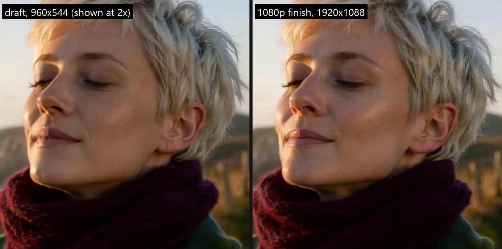
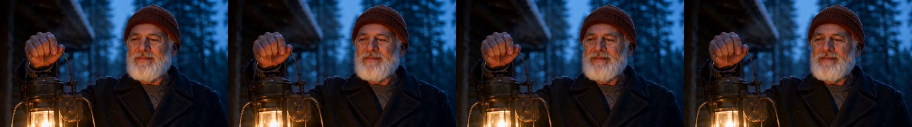

[Kinoloom](../README.md) › [Docs](README.md) › Showcase

# Showcase: how the samples were made

> **In short.** Every video and image in the README's showcase was made on one PC with an RTX 3070 8 GB. This page covers how each one was made, how long every step took from a cold start and what that comes to warm, what the seam QA measured, and what is wrong with each sample. It also records three MiniMax H3 takes that were rendered but are not published (see the note below). Every number comes from a saved record; [Records](#15-records) lists where each one lives.

The machine: RTX 3070 8 GB, i9-10980XE, 64 GB RAM, Windows 11, NVIDIA driver 616.64. Each model ran on its own isolated ComfyUI instance. The forest take (section 10) is an earlier H3 gate chain, and the two gallery stills (section 11) come from the studio's Image Studio (then called Images). The records themselves are gitignored and not redistributed.

> **Why the MiniMax H3 takes are not shown.** Three of the samples on this page are MiniMax H3 takes: the cliff walk (section 6), the kitchen (section 7) and the forest road (section 10). The [MiniMax H3 Community License](https://huggingface.co/MiniMaxAI/MiniMax-H3/blob/main/LICENSE) grants use of the model only outside the European Union, the United Kingdom, South Korea and the United States, and its §V.4 applies the same limit to displaying the model's outputs. I live in the EU, so the H3 renders, stills and frame strips are not published. Their sections keep everything else: how each take was made, every timing, the seam QA and the cast identity scores. The requests that made them are in [`docs/showcase/inputs/`](showcase/inputs/).

## At a glance

| Sample | Model | Length | Render time, warm (as rendered) | Joins | What's wrong with it |
| :--- | :--- | :--- | :--- | :--- | :--- |
| [Forest road](#10-minimax-h3-the-forest-road) (not shown) | MiniMax H3, Singularity checkpoint | 27.1 s, 4 links | 2 h 15 min of step time | all 3 pass | fails the drift gate; her identity score drops in the last link |
| [Cliff walk](#5-ltx-25-the-cliff-walk) | LTX-2.5, `ltx25_s6_cq` | 16.0 s, 4 links | about 28 min (29.5 min) | all pass the pop gate, 1 detail flag | she looks older by the end; fails drift and overlap gates |
| [Cliff walk](#6-minimax-h3-the-cliff-walk) (not shown) | MiniMax H3, `minimax_h3_hero_v2` | 12.25 s, 3 links | about 66 min (70.2 min) | both pass | the scarf end turns rust-red; fails the drift gate |
| [Kitchen](#7-minimax-h3-tea-in-the-kitchen) (not shown) | MiniMax H3, `minimax_h3_hero_v2` | 12.25 s, 3 links | about 71 min (72.0 min) | both pass | dialogue not transcribed; fails the drift gate |
| [Letter](#8-ltx-25-the-letter-by-the-window) | LTX-2.5, `ltx25_s6_cq` | 16.0 s, 4 links | about 26 min (33.8 min, with one re-draft) | all pass the pop gate, 3 detail flags | slight softening at frame 193; needed one re-prompt |
| [Lantern](#9-ltx-25-the-lantern-in-the-snow) | LTX-2.5, `ltx25_s6_cq` | 16.0 s, 4 links | about 29 min (29.7 min) | frame 193 fails pop and saturation; 1 detail flag | the warm light on his cheek dips at frame 193; link 2 skips its action; his identity score falls in links 3-4 |
| [Stills](#4-stills-qwen-image-21-fast) | Qwen-Image 2.1, fast | 9 stills, 2688x1536 | 38-78 s warm, 99-225 s cold | | a 125 s and a 158 s stall in an upscale |
| [Gallery](#11-two-more-qwen-stills-from-image-studio) | Qwen-Image 2.1, fast | 2 stills, 2048x2048 | 304 s and 397 s (an older setup) | | |

## On this page

1. [The samples](#1-the-samples)
2. [How they were made](#2-how-they-were-made)
3. [Inputs](#3-inputs)
4. [Stills: Qwen-Image 2.1 fast](#4-stills-qwen-image-21-fast)
5. [LTX-2.5: the cliff walk](#5-ltx-25-the-cliff-walk)
6. [MiniMax H3: the cliff walk](#6-minimax-h3-the-cliff-walk)
7. [MiniMax H3: tea in the kitchen](#7-minimax-h3-tea-in-the-kitchen)
8. [LTX-2.5: the letter by the window](#8-ltx-25-the-letter-by-the-window)
9. [LTX-2.5: the lantern in the snow](#9-ltx-25-the-lantern-in-the-snow)
10. [MiniMax H3: the forest road](#10-minimax-h3-the-forest-road)
11. [Two more Qwen stills from Image Studio](#11-two-more-qwen-stills-from-image-studio)
12. [Continuity, measured](#12-continuity-measured)
13. [Cast identity through the take](#13-cast-identity-through-the-take)
14. [What the samples do not show](#14-what-the-samples-do-not-show)
15. [Records](#15-records)
16. [Reproduce a sample](#16-reproduce-a-sample)

## 1. The samples

| Sample | Model and tier | Inputs (Qwen stills) | Take |
|---|---|---|---|
| Cliff walk | LTX-2.5, `ltx25_s6_cq` | `maren_portrait`, `cliff_open` | 16.04 s: 4 links, 385 frames, 1920x1088 at 24 fps, AAC 48 kHz stereo |
| Cliff walk | MiniMax H3, `minimax_h3_hero_v2` | the same two stills | 12.25 s: 3 links, 294 frames, 1920x1088 at 24 fps, AAC 32 kHz stereo |
| Kitchen, two speaking parts | MiniMax H3, `minimax_h3_hero_v2` | `ruth_portrait`, `lena_portrait`, `kitchen_open` | 12.25 s, as above |
| Letter by the window | LTX-2.5, `ltx25_s6_cq` | `theo_portrait`, `letter_open` | 16.04 s, as for the LTX cliff walk |
| Lantern in the snow | LTX-2.5, `ltx25_s6_cq` | `elias_portrait`, `lantern_open` | 16.04 s, as for the LTX cliff walk |
| Forest road, two people (section 10) | MiniMax H3, Singularity v1.3 checkpoint, lab gate chain | two cast portraits and an opening frame from an earlier project (not Qwen stills of this run) | 27.125 s: 4 links, 651 frames, 1920x1088 at 24 fps, AAC 32 kHz stereo |

The README shows the three LTX-2.5 takes as 1280x726 re-encodes (H.264, CRF 23, made from the CRF-16 1080p takes) and GIF previews, all in [`docs/showcase/`](showcase/). The 1080p takes themselves are in the gitignored run directories.

The stories are deliberately simple: one location, one or two people, one continuous action per link, and a camera that moves slowly. Each sample tests continuity, the same person, light and place across every join, not how much action a model can handle.

## 2. How they were made

**Stills: Qwen-Image 2.1, fast mode** (`qwen21_fast` in `tool/models.py`):
- Q5_K_M GGUF with the Pruna DMD 8-step LoRA, 8 steps, CFG 1.0, euler/simple; the text encoder runs on the CPU.
- 1344x768, finished 2x with 4x-UltraSharp then x0.5, giving 2688x1536.
- The graphs are the studio's own builders, `models.build_workflow` and `models.build_ref_workflow`, on a dedicated `ComfyUI_Qwen21` instance started with the studio launcher's `--highvram`.

Each still was rendered at two seeds and one was picked by eye; the reason for each pick is recorded. The cast portraits follow the format of the gate chains' portraits: three-quarter pose, mid-thigh up, seamless grey backdrop. The opening frames were then rendered with the portraits as Qwen's native references ("the woman from image_1"), so the person in the opening frame is the person in the portrait.

**Video: the seamless-chain engine** (`tool/chain_engine.py`, explained in [SEAMLESS_CHAINS.md](research/SEAMLESS_CHAINS.md)):
- Each chain request (prompts, seed, segment length, start image, cast) was turned into a chain spec by the same functions `chain_studio.run_chain` uses for a Video Studio chain: link frame counts, per-link seeds, reference slots, face close-ups and the cast line for LTX; for H3, the tier's own recipe read from the graph `video_studio` builds for it.
- The lab harness (`tool/scripts/chain_lab.py` with `--request`) then ran the chain on its own instance: LTX on :8289, H3 on :8299. The harness checks every graph against `/object_info` before it spends GPU time, keeps a 2 s VRAM/RAM/power trace and a stall watchdog, and writes one record per step.
- The chain spec, the graphs and the engine are the studio's; the runner and the instance management are the lab's, so these takes did not use the studio UI, its GPU broker or the `StudioRunner`. A chain rendered through Video Studio itself is recorded in [SEAMLESS_CHAINS_04](research/SEAMLESS_CHAINS_04_STUDIO_INTEGRATION.md) §6.

| | LTX-2.5 (`ltx25_s6_cq`) | MiniMax H3 (`minimax_h3_hero_v2`) |
|---|---|---|
| Weights | 22B distilled W4A8 transformer, Gemma-4 12B W4A8 text encoder, MSR LoRA (the CQ LoRA is off in chains: `LtxChainSpec.cq_strength` 0.0, because at 0.6 it aged the cast) | pruned ref2va W4A8 checkpoint (not the Singularity one), Qwen3-VL 32B W4A8 text encoder |
| Link render | stage 1 draft at 960x544, 6 steps (euler ancestral, sigmas 1.0 .. 0); 25-frame soft-pinned latent carry | 960x544, 32 steps, shift 12 / 3, exact 39-frame audio-video latent carry |
| 1080p | stage 2 per link: the draft latent upsampled 2x and refined in 2 steps from sigma 0.55; then the take decoded once at 1920x1088 | the whole take refined once (`MMH3SplitUpscale`, sigmas 0.45 .. 0, 1024x704 tiles), decoded once at 1920x1088 |
| Sound | the take's audio joined in latent space and decoded once | part of the audio-video latent, decoded with the take |
| Link frames | 97 / 121 / 121 / 121 at 24 fps: each link adds 4 s | 90 / 141 / 141 at 24 fps |
| Instance | `--enable-dynamic-vram --bf16-vae`; models unloaded between steps (lab clean state) | `--enable-dynamic-vram`; models kept loaded across links, the server restarted before any step that would drop a model in-process |

Each chain ran in two commands: first the links, with the 544p take decoded and QA'd, then the 1080p pass. The 544p take was reviewed in between, so no 1080p time would go into a chain whose motion or identity was wrong.

That review rejected one take, the letter (LTX). Early in link 3, at frames 218-220 (link 3's new frames start at 193), the model dissolved into a reverse angle: a cut inside a link, not at a join, which put the desk lamp on the other side of the frame. The prompts of links 3 and 4 were reworded once to hold the camera angle, and the chain was re-drafted from link 3. Links 1 and 2 were reused unchanged: the engine skips any step whose graph digest and inputs are unchanged. The rejected take is kept with the records (`output/showcase/ltx_letter/attempt1/`).

Two more LTX chains were rendered the same way, and both passed that review. One is the lantern ([section 9](#9-ltx-25-the-lantern-in-the-snow)). The other, a woman misting ferns in a rainy greenhouse, was dropped after its 1080p pass: the brass mister in her hand doesn't fit her grip and doesn't look like a mister. Its stills and run records are kept with the others, but it is not in the repository.

**Render times, warm and as rendered.** For scale, one single 5-second clip at 1080p takes about 6 minutes with LTX-2.5 and about 20-22 minutes with MiniMax H3, warm. Warm means the model is already loaded, which is the normal case when you render one clip after another; by default the studio keeps a model loaded for 8 minutes after a job (`gpu_broker`, `default_ttl_minutes`). The measured warm runs:
- LTX-2.5 `ltx25_s6_cq`: 352 s for a 5-second clip (the CQ adoption run in the archived LTX lab report, [VIDEOLAB_ARCHIVE_INDEX.md](research/VIDEOLAB_ARCHIVE_INDEX.md); the report itself is not in this repo).
- MiniMax H3 hero v2: 1,227.2 s (20.5 min) for a 124-frame clip, text to video without reference images (lab run `hero_v2_s32_r0`, on the fl2va checkpoint, 13 nodes cached from the run before). The tier's `vram_note` in `tool/video_models_user.json` rounds this to ~20.4 min.
- With reference images, as in these chains, each H3 step is slower. Two cold runs from the same day measured 16.95 s per step with references (`iceq_h3`, ref2va checkpoint) against 15.87 s without (`hero_v2_crf16`, fl2va checkpoint), about 7% more. That puts a warm H3 clip with references at about 22 min. It is an estimate, not a run, and a rough one: the two runs also differ in checkpoint, prompt and seed.
- The other H3 1080p tiers took 14-25 min per clip in the lab runs, depending on their step count.

Every chain below ran as the first job on freshly started instances, so the measured totals include starting the servers and loading the models. The warm estimate takes out only the start-up times the records show:
- the instance boots at the start of each of the two commands. The studio runs a chain as one job on a server that is already up. It still restarts H3 on purpose before the 1080p steps, and those restarts stay in.
- link 1's extra time in the loader and text-encode nodes, over link 2's. Link 2 ran on the warm server.

| Sample | As rendered | Taken out | Warm estimate | Per link |
|---|---|---|---|---|
| LTX-2.5 cliff walk | 1771 s | boots 16 + 14 s; link 1's extra 33.7 s | 1707 s, about 28 min | about 7 min |
| MiniMax H3 cliff walk | 4214 s | boots 13 + 13 s; link 1's extra 200.4 s (72.1 s in the cold loaders, the rest in the first prompt and reference encode) | 3988 s, about 66 min | about 22 min |
| MiniMax H3 kitchen | 4318 s | boots 14 + 13 s; link 1's extra 34.0 s (the weights were most likely still in the file cache) | 4257 s, about 71 min | about 24 min |
| LTX-2.5 letter, without the re-draft | 1612 s | boots 16 + 14 s; link 1's extra 33.6 s | 1548 s, about 26 min | about 6.5 min |
| LTX-2.5 lantern | 1779 s | boots 20 + 13 s; link 1's extra 25.8 s | 1720 s, about 29 min | about 7 min |

For the LTX chains this is, if anything, a little high. The lab also unloaded the LTX models between steps, and the loaders took about 5 s on each later step; that time stays in. Per second of finished video a chain costs more than single clips: about 1.6-1.8 min for these LTX chains against 1.2 for a single LTX clip, and 5.4-5.8 min for the H3 chains against about 4.0-4.3. Each link renders its overlap with the link before it again (that is what hides the join), and the chain adds a preview of the whole take, QA of every join and, for H3, the restarts.

## 3. Inputs

The image plan and the five chain requests (every prompt and seed of the delivered takes) are in [`docs/showcase/inputs/`](showcase/inputs/). The letter's request has the reworded prompts of links 3 and 4; the original ones of the rejected attempt are only in its run records (`20261024_051444_ltx_req_ltx_letter/draft_l3` and `draft_l4`, `graph.json`).
- LTX prompts are one motion-first paragraph per link: the establishing sentence, the action, the camera, then the diegetic sound.
- H3 prompts use the six-section Ref2VA layout (references, spatial and gaze anchors, timeline, camera, soundscape, constraints).
- Seeds are the request's seed plus the link index, except where a re-roll changed one (below).

The same folder also has the record of the forest take (`h3_forest_gate.json`: prompts, seeds, models and refine settings, section 10) and of the two gallery stills (`qwen_gallery.json`, section 11). Those two files document the samples; they don't reproduce them, because the forest take's references are not in the repository.

## 4. Stills: Qwen-Image 2.1 fast

Fourteen renders (seven stills, two seeds each) in two batches, then two more batches for the lantern take. Each batch ran on a freshly started instance. Times are per render, as the harness recorded them; the instance boot is separate.

| Batch | Boot | First render (cold) | Later renders (warm) | Batch wall |
|---|---|---|---|---|
| 4 cast portraits, no references | 15 s | 99.0 s: CPU text encode 34 s, sampling 44 s | 58.0-58.5 s for a new prompt; 38.1-38.5 s for a prompt's second seed, whose text encode is cached | 449 s |
| 3 opening frames, 1-2 portrait references | 13 s | 190.1 s, see below | 72.3 / 77.5 s for a new prompt; 39.2 / 45.9 / 46.8 s for a second seed | 490 s |
| Lantern: `elias_portrait`, no references | 29 s | 115.5 s: CPU text encode 43 s, sampling 50 s | 40.3 s for the second seed | 289 s |
| Lantern: `lantern_open`, 1 portrait reference | 13 s | 224.6 s, see below | 40.0 s for the second seed | 402 s |

The two lantern batches also rendered the portrait and the opening frame of the dropped greenhouse chain ([section 2](#2-how-they-were-made)), two seeds each, at 40.2-78.3 s per render. The batch walls include them.

The first reference render spent 125 s in its upscale step (the 4x-UltraSharp pass), against 10-17 s in every other render, and the harness's starvation warning fired (100 % utilisation at under 110 W for 2 minutes). Its VRAM, utilisation and power looked like the upscale step of a normal render, so only the duration marks it. Even under `--highvram`, ComfyUI unloads part of the DiT during every render (two "Unloaded partially" lines per render in the server logs), so that alone doesn't explain it either. The cause was not found; the five reference renders after it were normal.

It happened once more: `lantern_open` at seed 24511, again the first render with a reference on a freshly started instance, spent 158.4 s in the same step, and the warning fired again. The three reference renders after it spent 11-21 s there. Both stalls hit the first reference render of a fresh instance; the cause is still unknown.

| Still | Seeds | Picked | Why |
|---|---|---|---|
| `maren_portrait` | 24101 / 24102 | 24102 | face nearer frontal, with the freckles visible; scarf and cream cable sweater as written |
| `theo_portrait` | 24201 / 24202 | 24201 | curlier hair, matching the description; relaxed three-quarter pose |
| `ruth_portrait` | 24301 / 24302 | 24302 | chin-length bob as written (24301 is shoulder-length) |
| `lena_portrait` | 24401 / 24402 | 24402 | braid clearly over her left shoulder as written; natural three-quarter pose |
| `cliff_open` | 24111 / 24112 | 24111 | face warmly lit from the left as written; a fence post right beside her for the link-2 stop |
| `letter_open` | 24211 / 24212 | 24212 | face nearer the camera and better lit; rain on the glass, lamp in frame |
| `kitchen_open` | 24311 / 24312 | 24312 | both faces in clear three-quarter view toward the camera (identity, lip-sync); steam, teapot, mug |
| `elias_portrait` | 24501 / 24502 | 24501 | face nearer frontal and sharp, pale blue eyes; a full, neatly trimmed white beard and a double-breasted pea coat as written (24502 is single-breasted) |
| `lantern_open` | 24511 / 24512 | 24511 | face warmly lit and matching the portrait; a bright lantern, the glowing cabin window and visible falling snow (24512 is darker, with less snow) |

Both letter frames came out with the letter already open, so the chain's first LTX prompt was reworded before the chain ran, to start from an open letter rather than an unfolding one.

## 5. LTX-2.5: the cliff walk

| Step | Time | Notes |
|---|---|---|
| Instance boot (drafts) | 16 s | |
| Draft, link 1 (97 frames) | 189.5 s | cold: weights loaded and the prompt encoded; sampling 118.9 s |
| Draft, link 2, seed 2410242 | 129.9 s | rejected by the carry-end check (pop 1.301x against the 1.30 gate) |
| Draft, link 2, seed 2418161 | 129.8 s | kept (pop 1.131x): the engine's automatic re-roll |
| Drafts, links 3 and 4 | 129.9 / 129.8 s | sampling 95.7 / 95.8 s |
| Take audio, joined in latent space and decoded once | 2.0 s | carried audio latents exact (maximum error 0.0) |
| Draft take, decoded once (960x544) | 43.9 s | |
| *Command 1 wall time, including assembly and QA* | *894 s* | |
| Instance boot (1080p) | 14 s | |
| 1080p finish, links 1-4 | 108.4 / 134.6 / 133.6 / 134.0 s | sampling 57.0 / 76.9 / 76.5 / 76.6 s |
| 1080p take, decoded once (1920x1088) | 167.3 s | |
| *Command 2 wall time, including assembly and QA of both takes* | *877 s* | |
| **Total** | **1771 s (29.5 min)** | for 16.0 s of 1080p video with sound |
| Warm estimate | about 28 min (1707 s) | without the two boots and link 1's cold load ([section 2](#2-how-they-were-made)) |

The lab unloads every LTX model between steps (its clean state), so each step after the first reloads its weights from the OS file cache. The harness recorded about 5 s per step in the loader nodes. The studio keeps the models loaded across a chain instead.

*Frame 250 (link 3), the same 640x640 crop from both takes. Left: the 960x544 draft take, scaled 2x (Lanczos). Right: the 1080p take. Both come from the takes' CRF-16 mp4s. The 2-step finish adds fine detail the draft does not have: separate hair strands, the scarf's knit, skin texture.*

Seam QA of the 1080p take. The take has two kinds of boundary: the carry end, where a link's own frames start inside the carried overlap, and the junction, where the take joins the next link's latents.

| Boundary | Frame | Pop | dSat | Detail | Verdict |
|---|---|---|---|---|---|
| carry end, link 2 | 73 | 0.774x | -0.13 | 0.871 | pass |
| junction 1-2 | 97 | 1.102x | +0.25 | 1.125 | pass |
| carry end, link 3 | 169 | 1.041x | -0.47 | 1.046 | pass |
| junction 2-3 | 193 | 0.934x | -0.31 | 0.758 | **fail: detail** (below 0.85) |
| carry end, link 4 | 265 | 1.160x | +0.88 | 1.101 | pass |
| junction 3-4 | 289 | 0.850x | +1.04 | 0.872 | pass |

Take verdict: FAIL. Besides the detail flag at frame 193, it fails two take-wide gates:
- **drift:** from the first segment of the take (frames 0-72) to the last (frames 289-384), high-frequency detail falls 17.65 % (the worst of the four drift measures) and saturation 12.1 %. The QA cuts an LTX take at every join and every carry end, so it compares 7 segments. Link 4 ends on a medium waist-up walk again, like link 1, so the framing doesn't explain this on its own; the cause hasn't been isolated;
- **overlap:** PSNR of the carried frames in the per-link decodes, minimum 21.7 / 29.8 / 24.4 dB against the 32 dB gate. The carry is soft-pinned, so a link's own decode re-draws the carried frames slightly. The decode-once take does not use those per-link decodes.

Frames 191-194 across the flagged junction show no visible change:

Audio steps at the boundaries were 0.11-7.57 dB. The two above the 1.5 dB gate (7.57 dB at frame 97, 7.10 dB at frame 265) were not judged: the QA judges a level step only where the local level is above -45 dBFS, and they sit at -47.7 and -47.8 dBFS.

## 6. MiniMax H3: the cliff walk

*Not shown, for the licence reason at the top of this page. Same story and stills as the LTX-2.5 cliff walk (section 5).*

| Step | Time | Notes |
|---|---|---|
| Instance boot | 13 s | |
| Link 1 (90 frames) | 661.3 s | cold: the text encoder and the UNet loaded (72.1 s in the loader nodes), the prompt and references encoded; sampling 451.9 s |
| Links 2 and 3 (141 frames each, 39 carried) | 647.7 / 644.1 s | warm; sampling 639.9 / 636.4 s |
| Restart, then the 544p take decoded once | 20 s boot + 124.1 s | the server is restarted rather than dropping a model in-process |
| *Command 1 wall time, including the 544p take's encode and QA* | *2165 s* | |
| Refine conditioning | 13 s boot + 148.7 s | |
| Restart, then the 1080p refine of the whole take | 14 s boot + 1469.9 s | `MMH3SplitUpscale`, 90 progress steps |
| Restart, then the 1080p take decoded once | 13 s boot + 313.5 s | |
| *Command 2 wall time, including encode and QA* | *2049 s* | |
| **Total** | **4214 s (70.2 min)** | for 12.25 s of 1080p video with sound |
| Warm estimate | about 66 min (3988 s) | without the two command boots and link 1's cold load; the three restarts stay ([section 2](#2-how-they-were-made)) |

Seam QA of the 1080p take:

| Seam | Frame | Pop | dSat | Detail | Verdict |
|---|---|---|---|---|---|
| link 1-2 | 90 | 1.033x | -0.58 | 1.135 | pass |
| link 2-3 | 192 | 0.815x | +0.02 | 1.106 | pass |

Take verdict: FAIL on the drift gate only. From link 1 to link 3, saturation falls 12.45 %, and contrast (+5.2 %) and high-frequency detail (+6.3 %) are also past the 5 % gate. The 544p take had flagged seam 192 for detail (1.179 against 1.15); the 1080p refine brought it to 1.106.

## 7. MiniMax H3: tea in the kitchen

*Not shown, for the licence reason at the top of this page.* Two people, and dialogue.

| Step | Time | Notes |
|---|---|---|
| Instance boot | 14 s | |
| Link 1 (90 frames) | 537.9 s | a fresh process; the loader nodes took 1.9 s, against 72.1 s in the cliff chain's cold start, so the weights were most likely still in the OS file cache from the cliff chain (inferred, not checked); sampling 490.9 s (two portrait references) |
| Links 2 and 3 (141 frames each) | 692.0 / 695.9 s | sampling 680.6 / 684.8 s |
| Restart, then the 544p take decoded once | 20 s boot + 125.0 s | |
| *Command 1 wall time* | *2141 s* | |
| Refine conditioning | 13 s boot + 152.0 s | |
| Restart, then the 1080p refine | 13 s boot + 1591.6 s | |
| Restart, then the 1080p take decoded once | 13 s boot + 314.5 s | |
| *Command 2 wall time* | *2177 s* | |
| **Total** | **4318 s (72.0 min)** | for 12.25 s of 1080p video with two speaking parts |
| Warm estimate | about 71 min (4257 s) | without the two command boots and link 1's extra load time; the three restarts stay ([section 2](#2-how-they-were-made)) |

| Seam | Frame | Pop | dSat | Detail | Verdict |
|---|---|---|---|---|---|
| link 1-2 | 90 | 0.789x | +0.95 | 1.057 | pass |
| link 2-3 | 192 | 1.074x | -0.17 | 1.118 | pass |

Take verdict: FAIL on the drift gate only. From link 1 to link 3, high-frequency detail rises 31.0 % (most likely the push-in of link 2 and the closer framing; not isolated); lightness (-3.3 %), contrast (+0.6 %) and saturation (-2.4 %) stay within the gate. As with the cliff walk, the 544p take had flagged seam 192 for detail (1.191), and the 1080p take is within the gate (1.118). Audio at the seams:
- frame 90: a 7.68 dB step at -62 dBFS, below the -45 dBFS level at which the QA judges a step;
- frame 192: inside the dialogue at -16 dBFS, a 3.56 dB step, within the QA's local-rate rule: at most twice the median local step, which is 11.28 dB here, so the limit is 22.56 dB.

## 8. LTX-2.5: the letter by the window

| Step | Time | Notes |
|---|---|---|
| Attempt 1: drafts 1-4, take audio, draft take | 743 s wall | boot 16 s; draft 1 184.0 s (cold), drafts 2-4 127.6-129.9 s; rejected at review ([section 2](#2-how-they-were-made)) |
| Re-draft of links 3 and 4 with reworded prompts | 417 s wall | boot 13 s; links 1 and 2 reused; drafts 129.5 / 128.4 s; take audio 2.0 s; draft take 43.6 s |
| 1080p: finishes 1-4 and the take | 869 s wall | boot 14 s; finishes 106.3 / 133.3 / 132.9 / 132.3 s; take decode 167.0 s |
| **Total** | **2029 s (33.8 min)** | 1612 s (26.9 min) without the re-draft, as for a chain accepted on the first review |
| Warm estimate | about 26 min (1548 s) | without the re-draft, the two boots and link 1's cold load ([section 2](#2-how-they-were-made)) |

| Boundary | Frame | Pop | dSat | Detail | Verdict |
|---|---|---|---|---|---|
| carry end, link 2 | 73 | 1.000x | -0.09 | 0.960 | pass |
| junction 1-2 | 97 | 1.094x | -0.99 | 0.790 | **fail: detail** |
| carry end, link 3 | 169 | 1.143x | +1.46 | 1.019 | pass |
| junction 2-3 | 193 | 1.076x | -1.34 | 0.595 | **fail: detail** |
| carry end, link 4 | 265 | 0.967x | -0.73 | 1.175 | **fail: detail** (above 1.15) |
| junction 3-4 | 289 | 1.153x | -0.66 | 0.927 | pass |

Every boundary passes the pop and look gates. Three fail the detail ratio, which compares the sharpness of the 4 frames after a boundary with the 4 before it. At frame 193, the worst at 0.595, frames 192 and 193 compared at full resolution show a slight softening of the beard and skin texture. You can't see it in the 640 px review strip. Take verdict: FAIL; drift worst 9.15 % (lightness -9.2 %, contrast -5.7 %), overlap PSNR minimum 29.08 / 31.96 / 29.15 dB against the 32 dB gate. The audio step at frame 169 (14.5 dB) is inside an onset: a sound starting out of silence, which the QA reports rather than judges.

## 9. LTX-2.5: the lantern in the snow

*The full take as a 360 px, 8 fps preview; click it to download the 1280x726 mp4 with sound.*

**Story.** Blue hour on the snowy porch of a log cabin. Elias raises a lit storm lantern and looks out at the pine forest (link 1). He keeps it raised and smiles (link 2). The prompt of link 2 asked him to catch snowflakes in his free hand, and he doesn't. He lowers the lantern, closes his eyes and tilts his face up into the falling snow (link 3). Then the camera pulls back to the porch, with the lantern in his hand and the cabin window glowing behind him (link 4). As in the other samples: one person, one place, a slow camera. Every prompt is in [`docs/showcase/inputs/ltx_lantern.json`](showcase/inputs/ltx_lantern.json).

| Step | Time | Notes |
|---|---|---|
| Instance boot (drafts) | 20 s | |
| Draft, link 1 (97 frames) | 182.9 s | cold: weights loaded and the prompt encoded; sampling 121.6 s |
| Draft, link 2 | 132.4 s | sampling 97.7 s |
| Draft, link 3, seed 2410643 | 132.0 s | failed the carry-end check on saturation (-4.13) |
| Draft, link 3, seed 2418562 | 131.1 s | the engine's automatic re-roll; it failed on saturation too (-4.35), but scored closer to the gate (1.148 against 2.067, where 1.0 is at the gate), so the engine kept it |
| Draft, link 4 | 129.3 s | sampling 95.2 s |
| Take audio, joined in latent space and decoded once | 2.1 s | carried audio latents exact (maximum error 0.0) |
| Draft take, decoded once (960x544) | 43.6 s | |
| *Command 1 wall time, including assembly and QA* | *899 s* | |
| Instance boot (1080p) | 13 s | |
| 1080p finish, links 1-4 | 108.0 / 137.0 / 133.4 / 133.4 s | sampling 57.2 / 78.1 / 75.8 / 76.1 s |
| 1080p take, decoded once (1920x1088) | 166.8 s | |
| *Command 2 wall time, including assembly and QA of both takes* | *880 s* | |
| **Total** | **1779 s (29.7 min)** | for 16.0 s of 1080p video with sound |
| Warm estimate | about 29 min (1720 s) | without the two boots and link 1's cold load ([section 2](#2-how-they-were-made)) |

Seam QA of the 1080p take:

| Boundary | Frame | Pop | dSat | Detail | Verdict |
|---|---|---|---|---|---|
| carry end, link 2 | 73 | 1.079x | -1.43 | 0.941 | pass |
| junction 1-2 | 97 | 1.087x | +0.52 | 0.755 | **fail: detail** |
| carry end, link 3 | 169 | 1.105x | +1.34 | 1.044 | pass |
| junction 2-3 | 193 | 1.456x | -3.36 | 0.859 | **fail: pop, saturation, audio level** |
| carry end, link 4 | 265 | 1.144x | -0.34 | 1.029 | pass |
| junction 3-4 | 289 | 1.249x | +1.38 | 0.907 | pass |

The junction into link 3 is the weak point of this take. In the draft take it passed the pop gate (1.284x); the 1080p finish raised it to 1.456x, with a saturation step of -3.36 where the scene's own rate there is 1.13. At full resolution, the warm lantern light on his cheek dips slightly from frame 193 on; his face, pose and the lantern don't change. The audio steps 2.39 dB there, at -43.9 dBFS, just above the -45 dBFS level from which the QA judges a step.

*Frames 191-194 of the 1080p take (the QA's review strip). The light on his cheek is a little cooler from frame 193.*

Take verdict: FAIL. Besides those two boundaries, it fails two take-wide gates:
- **drift:** from the first segment of the take to the last, lightness rises 32.5 % (the worst of the drift measures) and contrast 15.95 %, and high-frequency detail falls 14.72 %. In between, the lantern goes down out of the frame in link 3 and comes back in link 4, and the framing moves from medium to close-up and back out; which of these drives the numbers hasn't been isolated;
- **overlap:** PSNR of the carried frames in the per-link decodes, minimum 26.02 / 30.59 / 29.07 dB against the 32 dB gate, for the same reason as in [section 5](#5-ltx-25-the-cliff-walk): the soft pin re-draws the carried frames slightly.

## 10. MiniMax H3: the forest road

This is the longest sample: 27 seconds, two people, one spoken line. It is the H3 gate chain (`lab_h3_gate_5c9b1e8b`): a 4-link story first rendered in Video Studio with the old engine, then rendered again with the seamless-chain engine to test it. The full engineering story of that chain, including the two blue screens it ran into, is in [SEAMLESS_CHAINS_02](research/SEAMLESS_CHAINS_02_H3_MEMORY_AND_CRASHES.md) §3 and §5. The take is not shown, for the licence reason at the top of this page.

**Story.** Two people walk a forest road in golden-hour light. She slows and stops, close to tears; he turns and touches her arm. In link 2 his prompt gives him one line ("Hey, I know it's hard. Look at that light—I'm pretty sure he's watching us from the sky."). In links 3 and 4 he holds her, and the camera moves into a close-up of her face on his shoulder. Every prompt is in [`docs/showcase/inputs/h3_forest_gate.json`](showcase/inputs/h3_forest_gate.json).

**Inputs.** Two cast portraits and an opening frame, 2752x1536 each, from that original project. No generation record was kept for them, so this page doesn't say which model made them, and they are not in the repository.

**How it was rendered** (from the link and refine graphs in the run records):

| | Setting |
|---|---|
| Weights | `Minimax-h3_Singularity_ref2va_v1.3_Pruned_w4a8.safetensors` (the lab's default H3 model, not the pruned ref2va checkpoint of sections 6-7), Qwen3-VL 32B W4A8 text encoder |
| Links | 4 links of 192 frames at 960x544, the last 39 frames of each link carried into the next; 32 steps, euler / simple, shift 12 / 3, comfy kitchen attention; seeds 437180088-437180091 |
| Joins | at frames 192, 345 and 498 (8.0, 14.375 and 20.75 s) |
| 1080p | the whole take refined once at 1920x1088 (`MMH3SplitUpscale`, 1024x704 tiles) from sigma 0.25: `0.2500, 0.1967, 0.1081, 0.0000`. A refine from 0.45 (R0) was rendered as well; the showcase uses the 0.25 one (R25). |
| Take | 651 frames, 27.125 s at 24 fps, AAC 32 kHz stereo, decoded once |

**Time.** These are the records of the steps that made this take. They add up to 8,101 s (2 h 15 min) of step time; each step's time is its wall time, model loading included. That is not a wall time like the other samples': the steps ran in several lab runs, with server boots, restarts and two blue screens between them. The total leaves out work that did not go into this take: a one-graph refine that was interrupted after 900.8 s (`20261023_180139_h3_gate_R0`), and the R0 refine variant rendered for comparison (166.7 + 3,653.1 + 725.7 s, `20261023_182700_h3_gate_R0`).

| Step | Time | Notes |
|---|---|---|
| Link 1 | 1,303.2 s | cold: encoder 39 s, reference encode 139 s, DiT load 32 s, sampling 1,088 s |
| Link 2 | 1,152.3 s | sampling 1,074 s |
| Link 3 | 1,291.1 s | a fresh process after the first of the two blue screens (14:46); sampling 1,082 s |
| Link 4 | 1,038.4 s | warm; sampling 1,026.5 s |
| 544p preview take, decoded once | 220.7 s | a fresh process, after the second (15:54) |
| 1080p refine conditioning | 173.1 s | |
| 1080p refine | 2,210.8 s | |
| 1080p take, decoded once | 711.4 s | |
| **Total** | **8,101.0 s (2 h 15 min)** | for 27.1 s of 1080p video with sound |

The two blue screens came at hand-overs between steps, when the lab harness (or ComfyUI's cache) dropped the loaded H3 models in-process. That cause is inferred from the timing and from where the 14:46 crash dump faults (the 15:54 dump was not analysed); it is not proven. The harness and the engine now restart the H3 server instead, and the Windows event log shows no blue screen or GPU driver error since the 15:54 crash ([SEAMLESS_CHAINS_02](research/SEAMLESS_CHAINS_02_H3_MEMORY_AND_CRASHES.md) §5).

**Seam QA of the 1080p take:**

| Seam | Frame | Pop | dSat | Detail | Verdict |
|---|---|---|---|---|---|
| link 1-2 | 192 | 1.105x | +0.77 | 1.150 | pass |
| link 2-3 | 345 | 1.280x | +1.37 | 1.100 | pass |
| link 3-4 | 498 | 0.963x | +0.59 | 1.073 | pass |

Take verdict: FAIL on the drift gate only. From link 1 to link 4, high-frequency detail falls 53.58 % (the gated texture measure, `hf`), saturation 9.43 % and lightness 1.03 %, and contrast rises 6.56 %. The Laplacian variance falls 81.16 %, but it is reported, not gated. The story moves from a wide walking shot into a darker, softer close-up, so drift was expected here. Audio at all three joins sits at -59 to -62 dBFS, below the -45 dBFS level at which the QA judges a step, and the 4.9 dB step at frame 498 is also marked as an onset.

**Against the old engine.** The old engine's Video Studio take of the same story (124-frame links, 496 frames, each link started from the last frame of the one before) failed all three joins: pop 3.06x / 2.25x / 2.16x, saturation +18.8 / +11.9 / +10.2. The new take's joins measure 1.105x / 1.280x / 0.963x (above). It is a different render of the same story, so this compares the old pipeline with the new one, not one mechanism with another.

## 11. Two more Qwen stills from Image Studio

| Anime style | Photo style |
| :---: | :---: |
|  |  |
| `img_00024`, seed 893960 | `img_00018`, seed 824807 |

Both were made in the studio's Image Studio (then called Images) with the same `qwen21_fast` mode: the Q5_K_M GGUF with the 8-step LoRA, 8 steps, CFG 1.0, euler / simple, text encoder on the CPU. They are square: a 1024x1024 latent, finished with 4x-UltraSharp then x0.5 to 2048x2048. The prompts and settings are copied from the image records into [`docs/showcase/inputs/qwen_gallery.json`](showcase/inputs/qwen_gallery.json).

The image records give 396.9 s (samurai) and 303.5 s (city walk) of execution time. Don't compare those with section 4. Both were made before the Qwen instance moved from `--lowvram` to `--highvram`, a change made because `--lowvram` let the model fall into per-module CPU dequantization at 20-100 s per step ([PROVEN_CONFIGS_QWEN21.md](research/PROVEN_CONFIGS_QWEN21.md)). So they most likely ran on the slow path; their records don't name the launch flags.

The PNGs carry an alpha channel (Qwen-Image 2.1 decodes RGBA), and it is not fully opaque. In the samurai image 9.9 % of the pixels are below 255 (out of 255), down to 149; only 0.09 % are below 250, mostly near the blue lightning and the figure on the right. In the city walk 43.2 % are below 255, but none below 246. The 1024 px JPEGs in the repository have no alpha.

## 12. Continuity, measured

The engine's take is decoded once from the links' joined latents. To show what that buys, the cliff walk and the letter were also put together the simple way: each link's own decode, cut together at the seams (carried frames dropped, the same take audio underneath). Nothing was re-rendered: the per-link decodes are files the draft and finish steps wrote anyway (`showcase.py compare-ltx`). Pop is the frame-difference jump at the seam against the local median; 1.0 means no jump, and the gate is 1.30.

| LTX cliff walk | Frame 97 | Frame 193 | Frame 289 |
|---|---|---|---|
| draft, per-link decodes cut together | 1.433x FAIL | 1.820x FAIL | 2.081x FAIL |
| draft, decode-once take | 1.069x | 0.790x | 0.886x |
| 1080p, per-link decodes cut together | 1.365x FAIL | 1.358x FAIL | 1.551x FAIL |
| 1080p, decode-once take | 1.102x | 0.934x | 0.850x |

| LTX letter | Frame 97 | Frame 193 | Frame 289 |
|---|---|---|---|
| draft, per-link decodes cut together | 1.649x FAIL | 2.097x FAIL | 2.538x FAIL |
| draft, decode-once take | 1.132x | 1.241x | 1.126x |
| 1080p, per-link decodes cut together | 1.349x FAIL | 1.559x FAIL | 1.783x FAIL |
| 1080p, decode-once take | 1.094x | 1.076x | 1.153x |

Both versions are built on the same soft-pinned latent carry, so what the hard cut adds is the step at each decode boundary, which the decode-once take removes. For scale only, since it is a different story: on the LTX gate chain, the old engine's joins popped 5.40x / 1.80x / 2.57x ([SEAMLESS_CHAINS.md](research/SEAMLESS_CHAINS.md)). For H3, the forest take against the old engine is in [section 10](#10-minimax-h3-the-forest-road).

## 13. Cast identity through the take

`face_drift` (the studio's drift report: InsightFace `buffalo_l` on the CPU, every 6th frame) compares each link's faces with the cast portrait. The identity score is the ArcFace cosine similarity; age is InsightFace's apparent-age estimate. The portraits themselves measure at the ages listed.

| Take | Person (portrait age) | Identity per link | Apparent age per link |
|---|---|---|---|
| LTX cliff walk | Maren (27) | 0.306 / 0.412 / 0.412 / 0.344 | 24.8 / 28.6 / 31.9 / 32.4 |
| H3 cliff walk | Maren (27) | 0.309 / 0.353 / 0.409 | 26.3 / 25.3 / 25.6 |
| H3 kitchen | Ruth (66) | 0.384 / 0.465 / 0.493 | 39.1 / 38.1 / 34.8 |
| H3 kitchen | Lena (25) | 0.433 / 0.372 / 0.443 | 23.5 / 23.1 / 23.0 |
| LTX letter | Theo (30) | 0.457 / 0.465 / 0.435 / 0.487 | 29.1 / 30.6 / 31.8 / 28.8 |
| LTX lantern | Elias (73) | 0.600 / 0.548 / 0.483 / 0.394 | 67.8 / 75.6 / 63.4 / 64.1 |

In the four takes other than the lantern, each person's identity score in the last link is at or above the first link's. Lena's dips in link 2 (0.372) and recovers. The lantern take is the exception: Elias starts higher than anyone else (0.600) and falls with every link, to 0.394. In links 3 and 4 his face is tilted back toward the sky, a pose that is hard for the face model; how much of the fall that explains hasn't been checked.

Apparent age:
- **LTX cliff walk:** Maren's rises by about 8 years over four links. This is the known LTX ageing issue ([SEAMLESS_CHAINS_01_LTX.md](research/SEAMLESS_CHAINS_01_LTX.md) §9), reduced but not solved. Link 3 is a close-up with her eyes closed part of the time, which may bias the estimate there.
- **LTX letter:** Theo's stays between 28.8 and 31.8 and ends where it started.
- **LTX lantern:** Elias's portrait measures 73 (the prompt asked for his mid-sixties). His links read 67.8 / 75.6 / 63.4 / 64.1, so no upward trend.
- **H3:** Maren and Lena stay within a year.
- **Ruth:** her portrait measures 66 but her video frames 35-39, although by eye she looks the same. For her the estimator does not carry across the two kinds of image, so only the trend within the take (39 to 35) is comparable.

**The forest take** was measured in the same way, against the same reference crops for every row ([SEAMLESS_CHAINS_02](research/SEAMLESS_CHAINS_02_H3_MEMORY_AND_CRASHES.md) §3; the man is measured in three links):

| Take | Woman, identity per link | Woman, age per link | Man, identity per link | Man, age per link |
|---|---|---|---|---|
| old engine | 0.32 / 0.29 / 0.23 / 0.18 | 24.9 / 31.6 / 27.3 / 25.8 | 0.40 / 0.31 / 0.25 | 29.2 / 36.7 / 31.0 |
| new, 1080p R25 (the delivered take) | 0.35 / 0.37 / 0.34 / 0.28 | 23.8 / 30.5 / 29.0 / 28.2 | 0.38 / 0.40 / 0.40 | 30.9 / 34.5 / 35.3 |

Identity falls less along the new chain than along the old one. The woman's score still drops in link 4 (0.28), the tight close-up of her face on his shoulder.

## 14. What the samples do not show

- **One seed per chain.** These are first renders, not the best of several. The selections were:
  - the two seeds per still;
  - the engine's automatic re-roll of one link in two LTX chains (the cliff walk's link 2 and the lantern's link 3);
  - the one re-prompt of the letter chain's links 3 and 4 ([section 2](#2-how-they-were-made));
  - dropping one whole chain, a greenhouse scene, after its 1080p pass ([section 2](#2-how-they-were-made));
  - for the forest take, the choice between the two 1080p refines (R25 over R0).
- **Every take fails a QA gate.** The drift gate (5 %) fails on every take, because lighting and framing change through a story; the gates are engineering thresholds for this machine, not perceptual ones ([SEAMLESS_CHAINS.md](research/SEAMLESS_CHAINS.md)). The per-seam flags are listed above.
- **Visible flaws:**
  - in the H3 cliff walk, the loose end of the scarf turns rust-red instead of burgundy in link 3, from the 544p links on;
  - the LTX lead ages in the cliff walk ([section 13](#13-cast-identity-through-the-take));
  - in the letter, the texture softens slightly at the junction into link 3 (frame 193, [section 8](#8-ltx-25-the-letter-by-the-window));
  - in the letter's link 3, the camera eases back as he leans back, and the background behind him turns from the room wall to the window. It is a gradual move, checked frame by frame, not a cut, and the lamp stays on the right;
  - in the lantern, link 2 skips its action: he never holds out his hand to catch the snow ([section 9](#9-ltx-25-the-lantern-in-the-snow));
  - in the lantern, the warm light on his cheek dips at the junction into link 3 (frame 193), and his identity score falls through links 3 and 4 ([section 13](#13-cast-identity-through-the-take)).
- **The dialogue was not transcribed.** No speech-to-text model was available, so whether the words match the prompts has not been checked. The only saved evidence of speech is the seam QA's audio level in the kitchen take: -16 dBFS inside the dialogue at seam 192. The forest take's line was not checked at all.
- **No H3 media.** The three H3 takes are described here but not shown (the licence note at the top of this page), so you can't judge them by eye from the repository.
- **Compression.** The GIFs are previews: the cliff walk at 400x227 and 10 fps, the letter and the lantern at 360x204 and 8 fps. The mp4s are 1280x726 H.264 at CRF 23, made from the CRF-16 1080p takes.
- **One machine.** All timings are for this one machine with these flags. The H3 weights sit on a SATA hard drive (`D:\H3_LAB\models`, a WDC WD5000AAKX). In the cold cliff chain, the H3 loader nodes took 72.1 s; in the kitchen chain, which started right after it, they took 1.9 s, most likely because the weights were still in the OS file cache.

## 15. Records

| Record | Path (gitignored) |
|---|---|
| Image renders, timings, picks | `output/showcase/images/images.json` |
| Console logs of the render commands (the `pick`, `cast`, `web` and `side` commands wrote none) | `output/showcase/log_*.txt` |
| Lab runs (graphs, events, telemetry, server logs, per-step results, take QA, seam strips) | `output/seamlab/runs/20261024_*` |
| Chain manifests (step digests, seeds, re-rolls) | `ComfyUI_LTX/output/studio_chain/show_*/manifest.json` |
| Lossless 1080p takes (FFV1, picture only) and the carried latents | `ComfyUI_LTX/output/studio_chain/show_*/` (5.82 GiB for the cliff walks, the kitchen and the letter, 2.34 GiB for the lantern) |
| Dropped greenhouse chain: stills, lab runs, chain state, cast identity | `output/showcase/images/nia_portrait.png`, `greenhouse_open.png`; `output/seamlab/runs/20261024_135953_ltx_req_ltx_greenhouse` and `20261024_141411_ltx_req_ltx_greenhouse` (`spec.json` holds the request as built); `ComfyUI_LTX/output/studio_chain/show_ltx_greenhouse/` (2.55 GiB); `output/showcase/ltx_greenhouse/cast_final.json` |
| Hard-cut comparisons | `output/showcase/ltx_cliff/compare/`, `output/showcase/ltx_letter/compare/` |
| Rejected letter take (attempt 1) | `output/showcase/ltx_letter/attempt1/` |
| Cast identity per link | `output/showcase/*/cast_*.json` |
| Timing table | `output/showcase/timings.json` |
| Forest take: link runs | `output/seamlab/runs/20261023_140354_h3_gate_R0` (links 1-2), `20261023_151355_h3_gate_R0` (links 3-4), `20261023_180139_h3_gate_R0` (544p preview take) |
| Forest take: 1080p refine R25, take and its QA | `output/seamlab/runs/20261023_194620_h3_gate_R25` (`spec.json`, `summary.json`, `qa_R25/seam_qa.json`, the step graphs) |
| Forest take: the R0 refine variant (not used) and the interrupted one-graph refine | `output/seamlab/runs/20261023_182700_h3_gate_R0`, `20261023_180139_h3_gate_R0` |
| Forest take: identity and age per link | `output/seamlab/analysis/session_2026-10-23/measurements/h3_age_old.json`, `h3_age_r25.json` |
| Blue screens during the H3 tests | Windows System event log (Kernel-Power 41, BugCheck 1001); `C:\Windows\Minidump\102326-*.dmp`, with two of the three copied to a folder outside the repository |
| Single-clip H3 times quoted in section 2 | the lab run logs `D:\H3_LAB\renders\<key>\run.json`: `c82b7f2d6c32c9b6ece36672` (`hero_v2_s32_r0`), `1b1b42425619c2df3d37f5fd` (`hero_v2_crf16`), `853cfcd08c03d32e3c1af9f1` (`iceq_h3`) |
| Forest take: the old engine's take and its QA | `output/videostudio/chain_5c9b1e8b_final.mp4`, `output/seamlab/baselines/baselines.json` (`h3_5c9b1e8b`) |
| Gallery stills: renders and their records | `output/images/img_00024.png` / `.json`, `output/images/img_00018.png` / `.json` |

## 16. Reproduce a sample

Run these from the repository root (the request files name their stills by repo-relative path). Each command starts and stops its own ComfyUI instance.
1. Render the cast portraits first, because the opening frames use them as references:
   `tool\.venv\Scripts\python tool\scripts\showcase.py images docs\showcase\inputs\plan_images.json --only maren_portrait,theo_portrait,ruth_portrait,lena_portrait,elias_portrait`.
2. Pick one seed per portrait: `tool\.venv\Scripts\python tool\scripts\showcase.py pick <id> <seed> --why "<reason>"`.
3. Render the opening frames the same way with `--only cliff_open,letter_open,kitchen_open,lantern_open`, and pick one seed for each. Without `--only`, the command stops before it renders anything, because it looks for the picked portraits first.
4. Run the chain in two commands, as the samples were run. The second builds on the chain state the first one leaves in `ComfyUI_LTX/output/studio_chain/<chain>/`.
   - LTX: `tool\.venv\Scripts\python tool\scripts\chain_lab.py ltx-gate --request docs\showcase\inputs\ltx_cliff.json --steps draft,audio,take,assemble --variant -`,
     then `tool\.venv\Scripts\python tool\scripts\chain_lab.py ltx-gate --request docs\showcase\inputs\ltx_cliff.json --steps finish,take,assemble`. Leave `--variant -` out of the second one: with it, the lab skips the 1080p take and its assembly. `ltx_letter.json` and `ltx_lantern.json` run the same way.
   - H3, only where the MiniMax H3 licence allows you to use the model: `tool\.venv\Scripts\python tool\scripts\chain_lab.py h3-gate --request docs\showcase\inputs\h3_cliff.json --steps link,decode`,
     then the same with `--steps refine,take`.

The forest take and the two gallery stills can't be reproduced from the repository alone: the forest take's references are not included, and the gallery stills came from Image Studio. Their records in `docs/showcase/inputs/` list every setting.

The renders are deterministic only up to the GPU kernels; a bit-exact repeat has not been tried.
